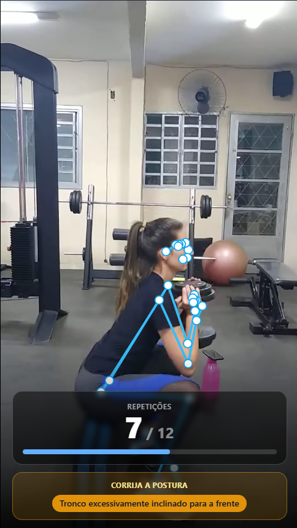
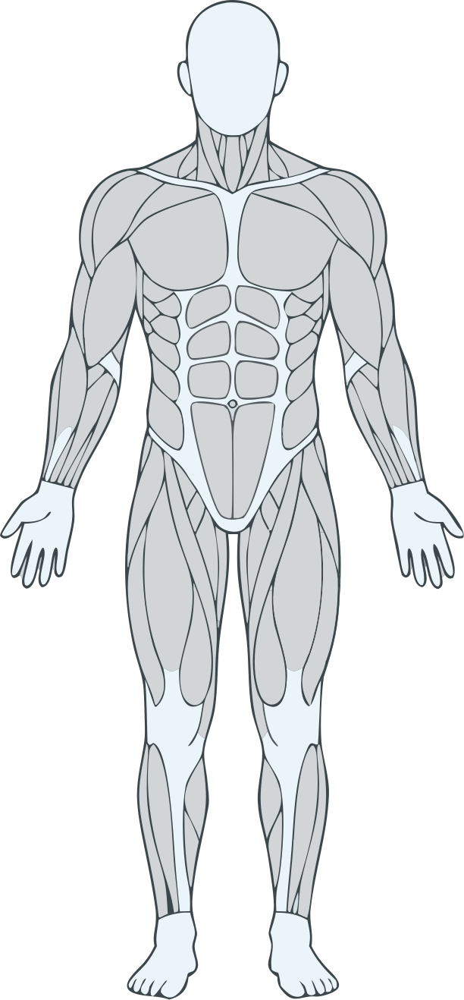
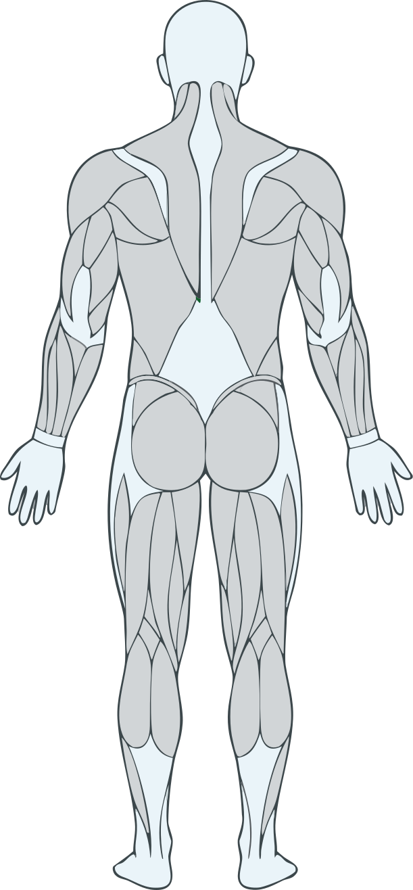

  
  <h3>Plataforma Inteligente de Telerreabilitação e Monitoramento Biomecânico Domiciliar</h3>
  

    Acompanhamento fisioterapêutico remoto assistido por visão computacional e inteligência artificial, 
    conectando clínicas, fisioterapeutas, pacientes e cuidadores através da câmera do smartphone.
  

  

    <a href="https://app.sinergiahealth.com.br"><strong>Aplicação em Produção</strong></a> ·
    <a href="https://app-hml.sinergiahealth.com.br"><strong>Ambiente de Homologação</strong></a> ·
    <a href="https://github.com/Sinergia-application/sinergia-docs/blob/main/docs/README.md"><strong>Portal de Documentação</strong></a> ·
    <a href="https://github.com/Sinergia-application/sinergia-docs/blob/main/docs/GUIA_DE_CONTRIBUICAO_E_DEPLOY_EQUIPE.md"><strong>Guia de Engenharia e Deploy</strong></a>
  

---

## Sobre a Plataforma

O **Sinergia** transforma o smartphone do paciente em um instrumento de apoio clínico para sessões de fisioterapia domiciliar. A plataforma permite que fisioterapeutas prescrevam roteiros terapêuticos personalizados, parametrizem amplitudes angulares específicas para a condição de cada indivíduo e acompanhem a execução dos exercícios à distância com métricas objetivas de movimento, estabilidade postural e evolução longitudinal.

Toda a inteligência computacional da plataforma opera como ferramenta de **apoio à decisão clínica**: o motor biomecânico identifica compensações posturais em tempo real e estrutura relatórios detalhados, preservando integralmente a soberania do fisioterapeuta sobre o diagnóstico, a avaliação final e a conduta terapêutica.

---

## Experiência Visual e Tecnologia Biomecânica

<table>
  <tr>
    <td width="45%" align="center">
      
      
<em>Interface de execução do paciente com rastreamento articular em tempo real, contagem automática e alerta postural contextual.</em>

    </td>
    <td width="55%" valign="top">
      <h3>Principais Capacidades Clínicas e Técnicas</h3>
      <ul>
        <li><strong>Inferência de Pose no Dispositivo:</strong> Processamento em tempo real diretamente no navegador (MediaPipe Pose e motor determinístico TypeScript), sem necessidade de sensores vestíveis ou hardwares dedicados.</li>
        <li><strong>Escalas Clínicas e Exercícios Dinâmicos:</strong> Suporte a exercícios de repetição isotônica, testes de sustentação isométrica estática e avaliações funcionais padronizadas como a Escala de Equilíbrio de Berg.</li>
        <li><strong>Parametrização Individualizada:</strong> Criação de instâncias customizadas de exercícios por fisioterapeuta, calibrando tolerâncias angulares para idosos, pós-operatórios e condições neurológicas como a Doença de Parkinson.</li>
        <li><strong>Enriquecimento Clínico Assistido por IA:</strong> Síntese automática de relatórios diferenciados para o paciente (linguagem motivadora e acessível) e para o fisioterapeuta (análise técnica longitudinal via Google Gemini), além de feedback auditivo via bips ou síntese de voz (ElevenLabs TTS).</li>
        <li><strong>Gestão de Retenção e Alertas Clínicos:</strong> Monitoramento contínuo da adesão em janela de 14 dias, alertas automáticos de queda de pontuação ou falha biomecânica recorrente e régua de engajamento via Web Push e e-mail.</li>
      </ul>
      

        
        &nbsp;&nbsp;&nbsp;&nbsp;
        
        
<em>Mapeamento anatômico integrado ao catálogo de exercícios da plataforma.</em>

      

    </td>
  </tr>
</table>

---

## Ecossistema de Repositórios e Ambientes

| Repositório | Stack Tecnológica | Papel na Arquitetura |
| :--- | :--- | :--- |
| [**`sinergia-web`**](https://github.com/Sinergia-application/sinergia-web) | Angular, TypeScript, Tailwind CSS, MediaPipe Pose, Cloudflare Workers | Aplicação Web Progressiva (PWA) para pacientes, fisioterapeutas, recepcionistas e administradores, contendo o motor biomecânico em tempo real e offline. |
| [**`sinergia-api`**](https://github.com/Sinergia-application/sinergia-api) | Java 21, Spring Boot 3, Spring Security (JWT), MariaDB, Flyway | Backend REST central responsável por multi-tenancy de clínicas, roteiros, armazenamento de mídia, reprocessamento de landmarks (`LandmarksReplayer`), integrações de IA e auditoria. |
| [**`sinergia-docs`**](https://github.com/Sinergia-application/sinergia-docs) | Markdown, Mermaid, GitHub Actions | Hub privado de documentação arquitetural, fluxos de negócio, especificações clínicas, conformidade LGPD e governança de engenharia. |
| [**`.github`**](https://github.com/Sinergia-application/.github) | Markdown, SVG, Templates GitHub | Vitrine institucional pública da organização e padrões de comunidade. |

### Ambientes Operacionais

| Ambiente | Aplicação Web (PWA) | API REST | Health Check |
| :--- | :--- | :--- | :--- |
| **Produção** | [`https://app.sinergiahealth.com.br`](https://app.sinergiahealth.com.br) | [`https://api-sinergia.yegear.dev`](https://api-sinergia.yegear.dev) | [`/api/v1/health`](https://api-sinergia.yegear.dev/api/v1/health) |
| **Homologação** | [`https://app-hml.sinergiahealth.com.br`](https://app-hml.sinergiahealth.com.br) | [`https://api-hml-sinergia.yegear.dev`](https://api-hml-sinergia.yegear.dev) | [`/api/v1/health`](https://api-hml-sinergia.yegear.dev/api/v1/health) |

---

## Central de Documentação Oficial

Toda a documentação técnica, clínica e operacional do ecossistema está estruturada e indexada em [**`docs/README.md`**](https://github.com/Sinergia-application/sinergia-docs/blob/main/docs/README.md) (e no índice consolidado [**`docs/INDICE_GERAL.md`**](https://github.com/Sinergia-application/sinergia-docs/blob/main/docs/INDICE_GERAL.md)):

| Domínio | Documentos Principais |
| :--- | :--- |
| **Engenharia e GitFlow** | [Diretrizes para Agentes de IA (`AGENTS.md`)](https://github.com/Sinergia-application/sinergia-docs/blob/main/AGENTS.md) [Guia Oficial de Contribuição, GitFlow e Deploys](https://github.com/Sinergia-application/sinergia-docs/blob/main/docs/GUIA_DE_CONTRIBUICAO_E_DEPLOY_EQUIPE.md) |
| **01. Arquitetura e Infraestrutura** | [Visão Geral do Sistema e Arquitetura Técnica](https://github.com/Sinergia-application/sinergia-docs/blob/main/docs/01-arquitetura-e-infra/visao-geral-e-arquitetura.md) [Pipelines de CI/CD, Ambientes e Monitoramento](https://github.com/Sinergia-application/sinergia-docs/blob/main/docs/01-arquitetura-e-infra/ci-cd-ambientes-e-monitoramento.md) [Arquitetura do Motor de Análise de Movimento e Escalas](https://github.com/Sinergia-application/sinergia-docs/blob/main/docs/01-arquitetura-e-infra/motor-analise-movimento-e-escalas.md) |
| **02. Fluxos do Sistema** | [Autenticação, Perfis de Acesso (RBAC) e Onboarding](https://github.com/Sinergia-application/sinergia-docs/blob/main/docs/02-fluxos-do-sistema/autenticacao-perfis-e-onboarding.md) [Gestão Multi-tenant de Clínicas, Equipe e Auditoria](https://github.com/Sinergia-application/sinergia-docs/blob/main/docs/02-fluxos-do-sistema/gestao-clinicas-equipe-e-auditoria.md) [Catálogo de Exercícios, Instâncias Personalizadas e TTS](https://github.com/Sinergia-application/sinergia-docs/blob/main/docs/02-fluxos-do-sistema/catalogo-exercicios-instancias-e-tts.md) [Prescrição de Roteiros, Sessão e Processamento de Análise](https://github.com/Sinergia-application/sinergia-docs/blob/main/docs/02-fluxos-do-sistema/roteiros-sessao-e-processamento-analise.md) [Agenda Clínica Compartilhada e Mensageria Contextualizada](https://github.com/Sinergia-application/sinergia-docs/blob/main/docs/02-fluxos-do-sistema/agenda-clinica-e-mensageria.md) [Aderência, Retenção, Notificações e Exportação de Relatórios](https://github.com/Sinergia-application/sinergia-docs/blob/main/docs/02-fluxos-do-sistema/aderencia-retencao-notificacoes-e-relatorios.md) |
| **03. Clínico e Biomecânica** | [Plano de Implementação Técnica — Reuniões Clínicas (Sprints 1 a 4)](https://github.com/Sinergia-application/sinergia-docs/blob/main/docs/03-clinico-e-biomecanica/plano-implementacao-reunioes-clinicas.md) [Análise Técnica e Biomecânica da Escala de Equilíbrio de Berg](https://github.com/Sinergia-application/sinergia-docs/blob/main/docs/03-clinico-e-biomecanica/analise-escala-de-berg.md) [Especificação do Exercício Berg 03 — Permanecer Sentado](https://github.com/Sinergia-application/sinergia-docs/blob/main/docs/03-clinico-e-biomecanica/especificacao-berg-03-sentado.md) |
| **04. Segurança e LGPD** | [Conformidade LGPD, Consentimento, Retenção de Mídia e Menores](https://github.com/Sinergia-application/sinergia-docs/blob/main/docs/04-seguranca-e-lgpd/lgpd-consentimento-e-menores.md) |
| **05. Institucional e Histórico** | [Apresentação Inicial do Projeto](https://github.com/Sinergia-application/sinergia-docs/blob/main/docs/05-institucional-e-historico/apresentacao-inicial-projeto.md) · [Fomento Centelha](https://github.com/Sinergia-application/sinergia-docs/blob/main/docs/05-institucional-e-historico/fomento-centelha-2026.md) · [Artigo Acadêmico](https://github.com/Sinergia-application/sinergia-docs/blob/main/docs/05-institucional-e-historico/artigo-academico/artigo_projeto_com_imagens.md) |
