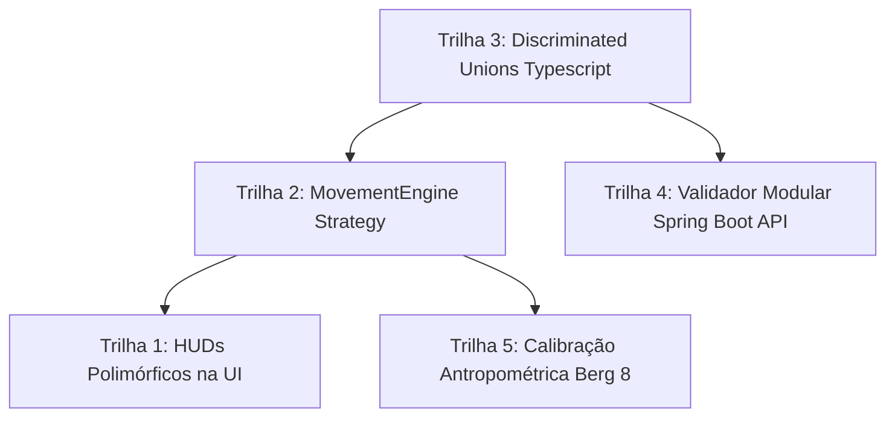

# Plano de Melhorias Arquiteturais: Motor de Análise de Movimento e Escalas Clínicas (Sinergia)

> **Documento de Especificação Técnica e Guia de Execução para Agentes / Desenvolvedores**  
> **Status:** Planejado para execução incremental  
> **Repositórios Envolvidos:** `sinergia-web` (Frontend), `sinergia-api` (Backend), `.github` (Docs)

---

## 1. Visão Geral e Motivação

Historicamente, o sistema **Sinergia** foi concebido focado em **exercícios dinâmicos de repetições** (agachamento, flexão de parede, elevação de perna, panturrilha). Toda a arquitetura inicial assumia:
1. Contagem de repetições baseada em ângulos articulares (`RepCounter`);
2. Ciclos de movimento finitos com fases (`ESPERANDO` $\rightarrow$ `DESCENDO` $\rightarrow$ `BOTTOM` $\rightarrow$ `SUBINDO` $\rightarrow$ `TOPO`);
3. Interface de captura orientada a repetições executadas vs meta de repetições.

Com a introdução de **Escalas Clínicas Funcionais** (como a **Escala de Equilíbrio de Berg**, testes de marcha e testes isométricos):
- Os exercícios deixaram de ser apenas de repetição e passaram a exigir:
  - **Permanência isométrica estática:** Berg 2, Berg 3, Berg 7 (segundos de estabilidade e faixas de pontuação 0 a 4);
  - **Deslocamento linear e alcance:** Berg 8 (alcance funcional medido em centímetros);
  - **Giro e velocidade angular:** Berg 11 (giro de 360° em tempo determinado);
  - **Movimentos compostos e transferências:** Berg 5 (sentar $\rightarrow$ levantar $\rightarrow$ transferir $\rightarrow$ sentar).

A refatoração inicial realizada na branch `feature/exercicio-3` introduziu com sucesso o padrão **Strategy** para posturas estáticas (`PostureProfile`). Este documento detalha as **5 melhorias arquiteturais estruturais** que devem ser executadas nos próximos ciclos para consolidar o sistema.

---

## 2. Trilha 1: Desacoplamento da UI via HUDs Polimórficos

### 2.1 Problema Atual
O componente [patient-exercise-session.component.ts](file:///d:/Projects/sinergia-web/src/app/features/patient/pages/patient-exercise-session/patient-exercise-session.component.ts) possui **mais de 1.600 linhas** e seu template HTML [patient-exercise-session.component.html](file:///d:/Projects/sinergia-web/src/app/features/patient/pages/patient-exercise-session/patient-exercise-session.component.html) concentra:
- Inicialização de câmera, detecção WebGL/MediaPipe e gerenciamento de permissões;
- Controles de gravação de vídeo offline e upload;
- Lógica de feedback de repetições (`repCount`, fases, arco ROM);
- Lógica de exercícios estáticos (`tempoValido`, `tempoCalibracaoRestante`, `scoreSugerido`, `bracosCruzados`);
- Múltiplos blocos `@if (isStaticExercise())` e condicionais aninhadas de renderização.

### 2.2 Arquitetura Proposta
Transformar o contêiner de sessão em um orquestrador puro de câmera e sessão, extraindo a camada de visualização (HUD — *Heads-Up Display*) em subcomponentes standalone dedicados por arquétipo:

```
src/app/features/patient/pages/patient-exercise-session/components/
├── hud-repetition/           # Exibe repetições, fase e barra de arco ROM
│   ├── hud-repetition.component.ts
│   └── hud-repetition.component.html
├── hud-static-posture/       # Exibe tempo de permanência, calibração, estabilidade e postura
│   ├── hud-static-posture.component.ts
│   └── hud-static-posture.component.html
└── hud-clinical-metric/      # Para futuros exercícios de medição (Berg 8 alcance cm, Berg 11 rotação)
    ├── hud-clinical-metric.component.ts
    └── hud-clinical-metric.component.html
```

### 2.3 Instruções para o Agente Executor
1. **Criar a interface comum de Props/Outputs de HUD:**
   ```typescript
   export interface BaseHudProps {
     trackingOk: boolean;
     activeFlags: string[];
   }
   ```
2. **Migrar o HTML de repetições** para `HudRepetitionComponent`:
   - Inputs: `repCount: Signal<number>`, `faseAtual: Signal<string>`, `romProgress: Signal<number>`.
3. **Migrar o HTML de postura estática** para `HudStaticPostureComponent`:
   - Inputs: `tempoDecorrido: Signal<number>`, `tempoValido: Signal<number>`, `tempoCalibracaoRestante: Signal<number>`, `estabilidadePct: Signal<number>`, `staticState: Signal<string>`, `postura: Signal<'em_pe' | 'sentado'>`, `scoreSugerido: Signal<number | null>`, `bracosCruzados: Signal<boolean>`.
4. **No template principal**, substituir o bloco condicional complexo por:
   ```html
   @switch (exerciseCategory()) {
     @case ('repeticao') {
       <app-hud-repetition [repCount]="repCount" ... />
     }
     @case ('estatico') {
       <app-hud-static-posture [tempoValido]="tempoValidoSegundos" ... />
     }
     @case ('metrica_clinica') {
       <app-hud-clinical-metric ... />
     }
   }
   ```
5. **Executar os testes:** Validar que `ng build` e `ng test` passem sem quebra de comportamento.

---

## 3. Trilha 2: Generalização do Motor de Movimento (`MovementEngineStrategy`)

### 3.1 Problema Atual
Atualmente, [realtime-frame-engine.ts](file:///d:/Projects/sinergia-web/libs/realtime-engine/src/realtime-frame-engine.ts) possui um acoplamento direto:
```typescript
if (this.staticEngine) {
  return this.staticEngine.processFrame(corpoRaw, dtMs);
}
// senão, processa como repetição convencional...
```
Conforme a Escala de Berg e novos testes funcionais forem implementados, novos motores serão necessários (ex.: motor de alcance em cm, motor de rotação axial 360°). Adicionar novos `if/else` no `RealtimeFrameEngine` violará o princípio Open/Closed (SOLID).

### 3.2 Arquitetura Proposta
Criar uma interface polimórfica para motores de frame em `libs/realtime-engine/src/engines/`:

```typescript
export interface MovementEngine {
  processFrame(corpoRaw: CorpoLandmarks, dtMs: number): FrameProcessResult;
  reset(): void;
  obterMetricas(): Record<string, unknown>;
}
```

E construir uma **EngineFactory**:
```
libs/realtime-engine/src/engines/
├── movement-engine.interface.ts
├── movement-engine.factory.ts
├── repetition-engine.ts           # Antigo fluxo de RepCounter + RuleEvaluator
├── static-posture-engine.ts       # Nosso motor estático com PostureProfile Strategy
├── displacement-reach-engine.ts   # Futuro: Berg 8 (Alcance anterior em cm)
└── rotational-engine.ts           # Futuro: Berg 11 (Giro 360°)
```

### 3.3 Instruções para o Agente Executor
1. Criar a interface `MovementEngine` em `libs/realtime-engine/src/engines/movement-engine.interface.ts`.
2. Fazer `StaticPostureEngine` implementar `MovementEngine`.
3. Extrair a lógica de repetição do `RealtimeFrameEngine` para `RepetitionEngine implements MovementEngine`.
4. Atualizar `RealtimeFrameEngine` para delegar exclusivamente para `this.engine: MovementEngine`, instanciado via `MovementEngineFactory.create(config, options)`.
5. Executar `npm run test:contract` para garantir que as fixtures existentes continuem executando identicamente.

---

## 4. Trilha 3: Tipagem Estrita via *Discriminated Unions* no TypeScript

### 4.1 Problema Atual
Em [types.ts](file:///d:/Projects/sinergia-web/libs/realtime-engine/src/types.ts), a interface `ProcessedExerciseConfig` e o retorno `FrameProcessResult` misturam propriedades de diferentes naturezas como opcionais:
```typescript
export interface ProcessedExerciseConfig {
  nome: string;
  modo?: 'repeticao' | 'estatico';
  angulo_min: number;              // Só faz sentido em repetição
  contagem?: {...};                // Só faz sentido em repetição
  estaticoConfig?: StaticPostureConfig; // Só faz sentido em estático
  ...
}
```
Isso permite que um desenvolvedor tente acessar acidentalmente `config.contagem` em um exercício estático, gerando *runtime bugs* que o TypeScript não detecta.

### 4.2 Arquitetura Proposta
Implementar uniões discriminadas pelo campo `tipo`:

```typescript
export interface BaseExerciseConfig {
  id?: string;
  nome: string;
  tempo_max_oclusao_ms?: number;
  camera?: CameraPlacementConfig;
}

export interface RepetitionConfig extends BaseExerciseConfig {
  tipo: 'repeticao';
  contagem: {
    landmarks: [string, string, string];
    min: number;
    max: number;
  };
  erros: ExerciseErrorRule[];
}

export interface StaticConfig extends BaseExerciseConfig {
  tipo: 'estatico';
  postura: 'em_pe' | 'sentado';
  plano_visao: 'sagital' | 'frontal';
  tempo_referencia_segundos: number;
  tolerancia_angular_graus: number;
  faixas_score?: BergScoreFaixa[];
}

export interface DisplacementConfig extends BaseExerciseConfig {
  tipo: 'deslocamento';
  landmark_origem: string;
  direcao: 'anterior' | 'lateral';
  distancia_referencia_cm: number;
}

export type ProcessedExerciseConfig = 
  | RepetitionConfig 
  | StaticConfig 
  | DisplacementConfig;
```

### 4.3 Instruções para o Agente Executor
1. Modificar `libs/realtime-engine/src/types.ts` introduzindo os tipos discriminados.
2. Atualizar [exercise-config.ts](file:///d:/Projects/sinergia-web/libs/realtime-engine/src/exercise-config.ts) para usar type guards e retornar o tipo discriminado correspondente.
3. Atualizar o consumidor em `realtime-session-collector.ts` e no HUD, aproveitando o *narrowing* automático do TypeScript:
   ```typescript
   if (config.tipo === 'estatico') {
     // Aqui o compilador sabe que config.tempo_referencia_segundos existe!
   }
   ```

---

## 5. Trilha 4: Validação Modular no Backend Spring Boot (`sinergia-api`)

### 5.1 Problema Atual
Em [RegrasAnaliseValidator.java](file:///d:/Projects/sinergia-api/src/main/java/com/sinergia/api/domain/analise/RegrasAnaliseValidator.java), a validação estrutural dos seeds do catálogo é feita em um único método estático cheio de `if (isEstatico)`:
```java
if (isEstatico) {
    validarEstatico(prefixo, root, erros);
} else {
    validarContagem(prefixo, root.get("contagem"), erros);
}
```
Se adicionarmos regras para `deslocamento`, `giro` ou `transferencia`, esta classe se tornará um gargalo de manutenção.

### 5.2 Arquitetura Proposta
Criar um **Registry de Validadores de Regras** usando Injeção de Dependências do Spring:

```java
package com.sinergia.api.domain.analise.validator;

public interface RegrasAnaliseTipoValidator {
    boolean suporta(String tipoOuModo);
    List<String> validar(String prefixo, JsonNode root);
}
```

Implementações:
- `RepeticaoRegrasValidator implements RegrasAnaliseTipoValidator`
- `EstaticoRegrasValidator implements RegrasAnaliseTipoValidator`
- `DeslocamentoRegrasValidator implements RegrasAnaliseTipoValidator` (futuro Berg 8)

E um validador agregador:
```java
@Component
@RequiredArgsConstructor
public class RegrasAnaliseCompositeValidator {
    private final List<RegrasAnaliseTipoValidator> validadores;

    public List<String> validar(String prefixo, JsonNode root) {
        String tipo = extrairTipo(root);
        return validadores.stream()
            .filter(v -> v.suporta(tipo))
            .findFirst()
            .map(v -> v.validar(prefixo, root))
            .orElseGet(() -> List.of(prefixo + ": tipo de exercício desconhecido: " + tipo));
    }
}
```

### 5.3 Instruções para o Agente Executor
1. Criar o pacote `com.sinergia.api.domain.analise.validator` no backend.
2. Criar a interface `RegrasAnaliseTipoValidator`.
3. Migrar a lógica de `validarContagem` para `RepeticaoRegrasValidator`.
4. Migrar a lógica de `validarEstatico` para `EstaticoRegrasValidator`.
5. Atualizar [ExercicioCatalogoSeeder.java](file:///d:/Projects/sinergia-api/src/main/java/com/sinergia/api/service/ExercicioCatalogoSeeder.java) e os testes unitários (`RegrasAnaliseValidatorTest.java`) para injetar o validador composite.
6. Executar `mvn test` para garantir conformidade em todos os seeds.

---

## 6. Trilha 5: Motor de Calibração Espacial Antropométrica (Pixels $\leftrightarrow$ Centímetros)

### 6.1 Problema Atual e Contexto Clínico
- O **Exercício 8 da Escala de Berg** (*Alcançar à frente com o braço estendido*) possui pontuação expressa em **centímetros absolutos**:
  - $\ge 25\text{ cm} \rightarrow \text{Score } 4$;
  - $\ge 12.5\text{ cm} \rightarrow \text{Score } 3$;
  - $\ge 5\text{ cm} \rightarrow \text{Score } 2$;
  - $< 5\text{ cm} \rightarrow \text{Score } 1$.
- Imagens 2D de câmeras de celular não possuem escala métrica nativa. Uma pessoa a 1.5 metro da câmera projeta o dobro de pixels do que uma pessoa a 3 metros.

### 6.2 Algoritmo de Calibração Antropométrica Proposto
Como o cadastro do paciente no Sinergia possui o campo `altura_cm` (ou este pode ser informado/confirmado antes da sessão), podemos calcular o fator de conversão de escala $\text{ratio}_{\text{px/cm}}$:

1. **Rastreamento de Segmentos Ósseos Estáveis no Baseline:**
   No enquadramento inicial estático (visão de perfil sagital), o paciente fica ereto.
   - Mede-se a altura corporal em pixels da imagem normalizada:
     $$H_{\text{px}} = \text{distância vertical}(Y_{\text{topo\_cabeca}}, Y_{\text{tornozelo}})$$
   - Ou mede-se o comprimento do segmento coxa/fêmur (`HIP` até `KNEE`) e perna/tíbia (`KNEE` até `ANKLE`), que compõem proporcionalmente cerca de $24.5\%$ e $24.6\%$ da estatura humana total (tabela antropométrica de Dempster/Winter).
2. **Cálculo da Taxa de Escala:**
   $$\text{Taxa Escala} = \frac{\text{Altura Estimada em Pixels}}{\text{Altura Real Cadastrada (cm)}} \quad [\text{pixels/cm}]$$
3. **Conversão de Deslocamento do Pulso:**
   $$\Delta X_{\text{cm}} = \frac{|X_{\text{pulso\_max}} - X_{\text{pulso\_inicial}}|}{\text{Taxa Escala}}$$

### 6.3 Instruções para o Agente Executor
1. Criar `libs/realtime-engine/src/spatial-calibration.ts`:
   - Função `calcularEscalaPixelsPorCm(corpo: CorpoLandmarks, alturaPacienteCm: number): number`.
2. Incluir verificação de estabilidade dos pés:
   - Se o tornozelo ou calcanhar se mover mais que $0.05$ normalizado no eixo X durante o alcance, sinalizar flag `passo_compensatorio_detectado`.
3. Criar fixture e teste de contrato para alcance à frente (`berg-08-reach-forward.json`).

---

## 7. Ordem de Implementação Recomendada



| Fase | Foco | Complexidade | Impacto |
| :--- | :--- | :--- | :--- |
| **Fase 1** | **Trilha 3 (Types)** + **Trilha 4 (API Registry)** | Baixa | Blindagem de tipo e fim do acoplamento no backend |
| **Fase 2** | **Trilha 1 (HUDs UI)** | Média | Redução do tamanho e complexidade do componente de sessão |
| **Fase 3** | **Trilha 2 (MovementEngine)** + **Trilha 5 (Escala cm)** | Média-Alta | Habilita os próximos exercícios de Berg (Ex 8 e Ex 11) |

---

## 8. Arquivos de Referência no Projeto

- Interface de Postura Estática atual: [posture-profile.ts](file:///d:/Projects/sinergia-web/libs/realtime-engine/src/posture-profiles/posture-profile.ts)
- Motor Estático atual: [static-posture-engine.ts](file:///d:/Projects/sinergia-web/libs/realtime-engine/src/static-posture-engine.ts)
- Componente de Sessão do Paciente: [patient-exercise-session.component.ts](file:///d:/Projects/sinergia-web/src/app/features/patient/pages/patient-exercise-session/patient-exercise-session.component.ts)
- Validador de Regras da API: [RegrasAnaliseValidator.java](file:///d:/Projects/sinergia-api/src/main/java/com/sinergia/api/domain/analise/RegrasAnaliseValidator.java)
- Análise da Escala de Berg: [Analise_escala_de_berg.md](file:///d:/Projects/.github/docs/Analise_escala_de_berg.md)
- Especificação Técnica Berg 3: [Berg_Ex3_Sentado.md](file:///d:/Projects/.github/docs/Berg_Ex3_Sentado.md)
