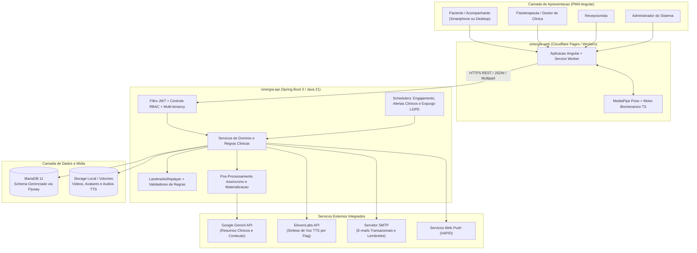
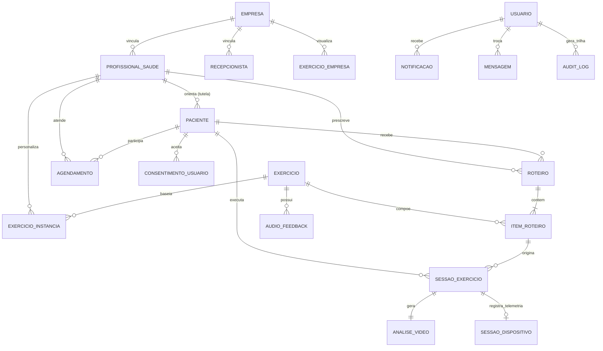

# Visão Geral do Sistema e Arquitetura Técnica

**Escopo:** Arquitetura integrada dos repositórios `sinergia-web` e `sinergia-api`  
**Última atualização:** Novembro de 2026

---

## 1. Propósito da Plataforma

O Sinergia é uma plataforma de telerreabilitação e acompanhamento fisioterapêutico domiciliar assistida por visão computacional e inteligência artificial. O objetivo do sistema é permitir que fisioterapeutas e clínicas prescrevam roteiros de exercícios personalizados, acompanhem a execução biomecânica realizada pelo paciente através da câmera do próprio smartphone ou computador e recebam indicadores objetivos de evolução, aderência e risco clínico.

A plataforma opera sob a diretriz de apoio à decisão clínica: os algoritmos de visão computacional e os modelos generativos estruturam métricas, detectam compensações posturais e sintetizam resumos, mas a validação final e a conduta terapêutica pertencem exclusivamente ao profissional de saúde responsável.

---

## 2. Topologia dos Componentes

A arquitetura atual do sistema é composta por dois repositórios principais de aplicação e um repositório central de governança:

1. **Frontend Web e PWA (`sinergia-web`):**
   - Desenvolvido em Angular com Tailwind CSS e distribuído como Progressive Web App (PWA) via Cloudflare Workers / Pages.
   - Executa localmente no navegador do paciente a inferência de pose corporal utilizando MediaPipe Pose e o motor determinístico `@sinergia/realtime-engine` em TypeScript.
   - Suporta execução em tempo real com feedback sonoro imediato e execução por gravação com análise no próprio navegador antes do envio.

2. **Backend e Motor Clínico (`sinergia-api`):**
   - Desenvolvido em Java 21 com Spring Boot 3, Spring Security (JWT), Spring Data JPA / Hibernate e migrações versionadas via Flyway sobre banco de dados relacional MariaDB.
   - Centraliza autenticação e controle de acesso baseado em papéis (RBAC), gestão multi-tenant de clínicas, prescrição de roteiros, armazenamento de mídia (`StorageService`), reprocessamento determinístico de landmarks em Java (`LandmarksReplayer`), enriquecimento assíncrono de relatórios via Google Gemini (`GeminiFeedbackService`), síntese de voz via ElevenLabs (`ElevenLabsTtsService`), notificações Web Push (VAPID) e disparo de e-mails transacionais.

3. **Governança e Documentação (`.github`):**
   - Repositório centralizador dos padrões de engenharia, GitFlow, especificações clínicas, diagramas arquiteturais e documentação dos fluxos de ponta a ponta.

> **Nota sobre evolução arquitetural:** Nas primeiras versões do projeto, o processamento de vídeo dependia de um serviço externo em Python (`sinergia-worker`) acoplado por filas RabbitMQ/Celery. Na arquitetura vigente, toda a extração de coordenadas articulares (landmarks) ocorre no cliente (`sinergia-web`) e o reprocessamento de regras biomecânicas roda nativamente na `sinergia-api` (`LandmarksReplayer`), eliminando a latência de fila de vídeo e reduzindo custos operacionais de infraestrutura.

---

## 3. Diagrama de Contexto e Integrações

---

## 4. Modelo de Domínio Principal

O diagrama abaixo representa as entidades centrais persistidas no MariaDB e seus relacionamentos estruturais:

---

## 5. Ambientes Operacionais e Isolamento

A infraestrutura do Sinergia mantém isolamento estrito entre os ambientes de Homologação e Produção, tanto na camada de aplicação quanto na camada de banco de dados e armazenamento de arquivos:

| Camada | Ambiente de Homologação | Ambiente de Produção |
|---|---|---|
| **Branch de Origem** | `develop` | `master` (mediante Pull Request aprovado e Tag SemVer) |
| **Frontend Web (PWA)** | `https://app-hml.sinergiahealth.com.br` | `https://app.sinergiahealth.com.br` |
| **Backend API REST** | `https://api-hml-sinergia.yegear.dev` | `https://api-sinergia.yegear.dev` |
| **Health Check** | `https://api-hml-sinergia.yegear.dev/api/v1/health` | `https://api-sinergia.yegear.dev/api/v1/health` |
| **Container de Banco** | `sinergia-mariadb-homolog` (rede isolada, porta interna/host `8081`) | `sinergia-mariadb` (volume dedicado de produção, porta `8080`) |

Detalhes operacionais sobre deploy contínuo, variáveis de ambiente, proxy reverso Nginx e certificados SSL encontram-se em [ci-cd-ambientes-e-monitoramento.md](ci-cd-ambientes-e-monitoramento.md).
