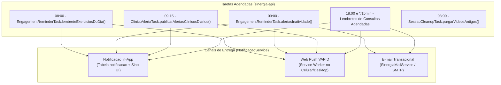

# Fluxo de Aderência, Retenção, Notificações Automáticas e Exportação de Relatórios

**Escopo:** Cálculo de adesão terapêutica, motor de alertas clínicos, régua de engajamento idempotente, Web Push, e-mails e relatórios gerenciais/clínicos (PDF e CSV)  
**Repositórios:** `sinergia-api` e `sinergia-web`

---

## 1. Cálculo de Aderência Terapêutica (`AdesaoCalculoService`)

A taxa de adesão do paciente mede a consistência de realização dos exercícios prescritos em uma **janela móvel de 14 dias**:

1. Para cada dia $d$ dentro dos últimos 14 dias corridos, o serviço consulta `RoteiroSessaoService#itensAgendadosParaDia(roteiroAtivo, d)`, que filtra os itens do roteiro ativo cuja coluna `dias_semana` inclui o dia da semana correspondente (ou todos os dias, quando `dias_semana` está vazio).
2. Conta-se quantos itens agendados tiveram sessão com análise efetivamente concluída (`StatusAnalise.CONCLUIDO`) naquela data.
3. A taxa percentual é obtida pela razão entre o total de itens concluídos e o total de itens previstos no período, limitada ao intervalo $[0\%, 100\%]$.

Esse indicador alimenta o painel do paciente (`patient-dashboard`), o painel do profissional (`professional-dashboard`), o cockpit de retenção (`professional-retention`) e o painel consolidado da clínica (`professional-empresa-dashboard`).

---

## 2. Detecção Automática de Alertas Clínicos (`ClinicoAlertaService`)

Para apoiar o fisioterapeuta no acompanhamento de dezenas de pacientes simultâneos, o sistema avalia automaticamente o histórico recente de sessões e identifica três categorias de atenção:

| Tipo de Alerta Clínico | Critério de Disparo | Parametrização na Clínica (`Empresa`) |
|---|---|---|
| **Queda de Pontuação Clínica** | A precisão/pontuação da última sessão concluída caiu pelo menos $X$ pontos em relação à sessão imediatamente anterior do mesmo item de roteiro. | `limiarQuedaPontuacaoClinica` (padrão: `15.0` pontos). |
| **Erro Biomecânico Recorrente** | Uma mesma flag postural (ex.: valgo dinâmico ou inclinação de tronco) repetiu-se nas últimas $N$ sessões consecutivas do exercício. | `sessoesErroRecorrenteAlerta` (padrão: `3` sessões). |
| **Inatividade Prolongada** | O paciente está há 3 ou mais dias sem registrar nenhuma sessão concluída (fora do período de graça pós-ativação). | Escalonado em marcos de `3`, `5`, `7`, `14`, `21` e `30` dias. |

---

## 3. Tarefas Agendadas e Régua de Engajamento Idempotente

O backend executa três componentes agendados (`@Scheduled`) que operam com chaves de idempotência persistidas na tabela `notificacao_idempotencia` (migration `V29__notificacao_idempotencia.sql`). Isso garante que um paciente ou profissional nunca receba notificações duplicadas para o mesmo evento diário, mesmo em caso de reinicialização do servidor.

### Respeito às Preferências de Lembrete (`LembretePreferenciaService`)
Antes de publicar qualquer lembrete automático, o serviço verifica a hierarquia de configuração:
1. Se a empresa do profissional desabilitou lembretes automáticos (`empresa.lembretesAutomaticosHabilitados = false`), nenhum disparo automático é feito para aquela carteira.
2. Caso a empresa permita, prevalece a preferência específica configurada pelo profissional para exercícios, inatividade ou agenda.

---

## 4. Arquitetura de Notificações In-App e Web Push (VAPID)

O sistema de notificações (`NotificacaoController`, `NotificacaoService` e `WebPushService`, migration `V12__create_notificacoes_e_push_subscriptions.sql`) opera em dois níveis sincronizados:

1. **Centro de Notificações In-App (`notification-bell.component.ts` e `notificacoes-page.component.ts`):**
   - Exibe contagem de não lidas (`GET /api/v1/notificacoes/nao-lidas/contagem`), filtra por categoria e permite navegação direta para o recurso associado através do campo `linkDestino` (por exemplo, abrir diretamente a análise recém-concluída ou a conversa no chat).
2. **Notificações Nativas via Web Push (PWA):**
   - O frontend obtém a chave pública VAPID em `GET /api/v1/notificacoes/push/vapid-key`, registra a assinatura no Service Worker do navegador e envia o `endpoint`, `p256dh` e `auth` para `POST /api/v1/notificacoes/push/subscribe` (tabela `inscricao_push`).
   - Sempre que `NotificacaoService` persiste uma nova notificação, `WebPushService` dispara de forma assíncrona o payload criptografado para todos os dispositivos inscritos daquele usuário, removendo automaticamente inscrições expiradas (`HTTP 404` ou `410`).

---

## 5. Cockpit de Retenção e Exportação de Relatórios (PDF e CSV)

### 5.1. Cockpit de Pacientes em Risco (`professional-retention.component.ts`)
Consome `GET /api/v1/profissionais/me/retencao` (`ProfissionalRetencaoService`), listando pacientes com baixa adesão, dias sem atividade ou alertas clínicos ativos. A interface oferece ações rápidas em um clique:
- Enviar mensagem contextualizada no chat;
- Agendar consulta de retorno/reavaliação;
- Abrir a última sessão com falha biomecânica;
- Acessar o prontuário detalhado do paciente.

### 5.2. Exportação de Relatórios Clínicos e Gerenciais
A plataforma gera documentos estruturados para prontuário, retorno médico ou prestação de contas da clínica:
- **Relatório Individual do Paciente (`RelatorioPacienteService`):**
  - `GET /api/v1/profissionais/me/pacientes/{pacienteId}/relatorio.pdf`
  - `GET /api/v1/profissionais/me/pacientes/{pacienteId}/relatorio.csv`
- **Relatório Consolidado da Clínica (`RelatorioEmpresaService`):**
  - `GET /api/v1/profissionais/me/empresa/relatorio.pdf`
  - `GET /api/v1/profissionais/me/empresa/relatorio.csv`

Todas as exportações são registradas automaticamente na trilha de auditoria (`AuditService`).

---

## 6. Referência Rápida de Arquivos

| Camada | Arquivos Principais |
|---|---|
| **Backend (`sinergia-api`)** | `AdesaoCalculoService.java`, `ClinicoAlertaService.java`, `ClinicoAlertaTask.java`, `EngagementReminderTask.java`, `EngagementReminderKeys.java`, `LembretePreferenciaService.java`, `Notificacao.java`, `NotificacaoService.java`, `WebPushService.java`, `SinergiaMailService.java`, `ProfissionalRetencaoService.java`, `RelatorioPacienteService.java`, `RelatorioEmpresaService.java` |
| **Frontend (`sinergia-web`)** | `features/professional/pages/professional-retention/`, `features/professional/pages/professional-dashboard/`, `features/patient/pages/patient-statistics/`, `shared/notification-bell/`, `features/shared/pages/notificacoes-page/` |
