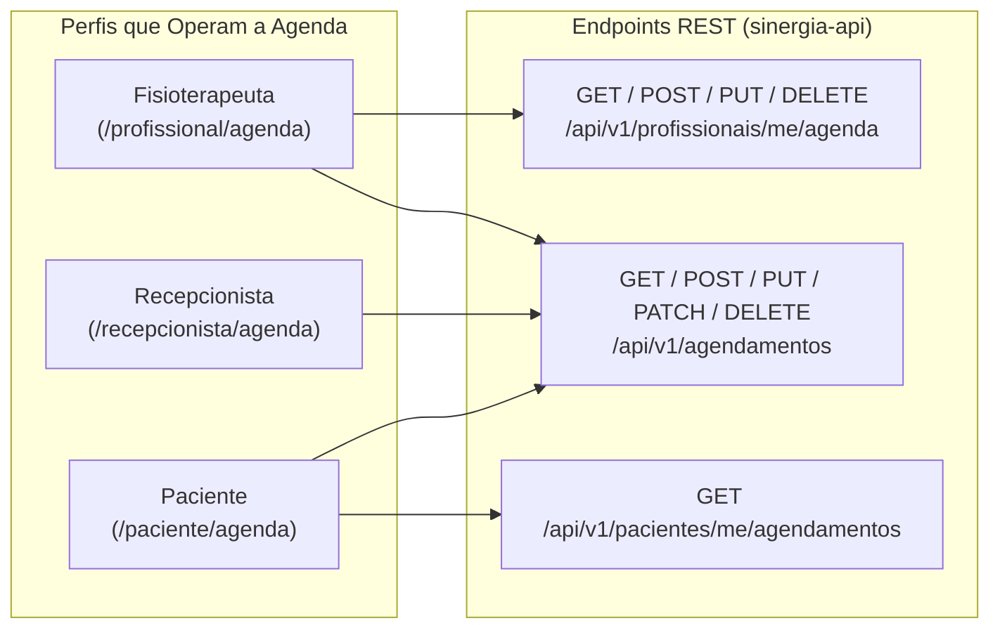
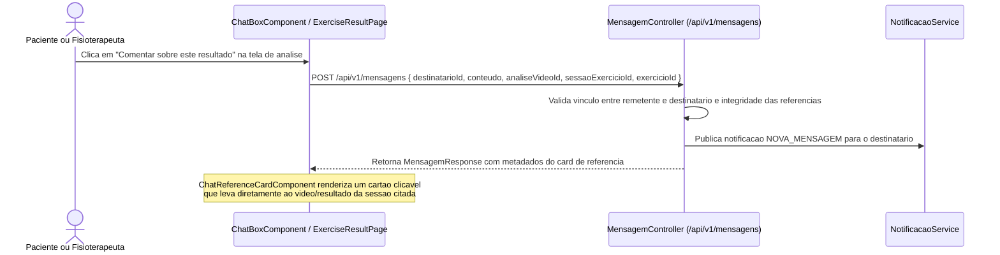

# Fluxo de Agenda Clínica Compartilhada e Mensageria Contextualizada

**Escopo:** Gestão de agendamentos presenciais e online, atuação integrada entre profissional, recepcionista e paciente, e sistema de mensagens internas com referências clínicas  
**Repositórios:** `sinergia-api` e `sinergia-web`

---

## 1. Agenda Clínica Compartilhada

O módulo de agenda (`Agendamento`, migrations `V5__perfil_usuario_agenda.sql` e `V17__agendamento_link_reuniao.sql`) integra a rotina de atendimentos entre o fisioterapeuta, a recepção da clínica e o paciente em uma interface unificada (`agenda-workspace.component.ts` e `patient-appointment-detail.component.ts`).

### 1.1. Estrutura do Agendamento
Cada registro na tabela `agendamento` contém:
- **Vínculos:** `paciente_id` e `profissional_id`.
- **Data, horário e duração:** `data` (`LocalDate`), `horario` (`LocalTime`) e `duracao_minutos` (padrão de 50 a 60 minutos).
- **Modalidade (`ModoAtendimento`):**
  - `PRESENCIAL`: atendimento físico na clínica ou em domicílio.
  - `ONLINE`: teleconsulta ou supervisão remota, acompanhada do campo `link_reuniao` (URL da sala de videoconferência).
- **Ciclo de Status (`StatusAgendamento`):**
  - `PENDENTE`: agendamento criado aguardando confirmação.
  - `CONFIRMADO`: atendimento confirmado na grade do profissional.
  - `CONCLUIDO`: sessão de atendimento realizada.
  - `CANCELADO`: agendamento desmarcado (libera o horário para novos encaixes).

### 1.2. Permissões e Operação por Perfil

- **Validação de conflito de horário (`AgendamentoService`):** Ao criar ou reagendar um compromisso, o serviço valida se o fisioterapeuta já possui outro agendamento ativo (`PENDENTE` ou `CONFIRMADO`) cujo intervalo `[horario, horario + duracaoMinutos)` se sobreponha ao horário solicitado.
- **Notificações imediatas e lembretes de consulta:**
  - Alterações na agenda geram notificações internas para a outra parte (`TipoNotificacao.AGENDA_ATUALIZADA`).
  - O agendador `EngagementReminderTask` envia lembretes automáticos na véspera da consulta (`lembreteConsultasAmanha`, às 18:00) e uma hora antes do início do atendimento (`lembreteConsultasProximaHora`, verificado a cada 15 minutos).

---

## 2. Mensageria Interna Contextualizada (`Mensagem`)

Para evitar que dúvidas sobre exercícios se percam em aplicativos externos sem contexto clínico, o Sinergia possui um canal de chat direto entre cada paciente e seu fisioterapeuta responsável (`MensagemController`, `MensagemService`, `chat-box.component.ts`).

### 2.1. Regras de Comunicação e Isolamento
1. **Pareamento estrito:** Um paciente só pode trocar mensagens com o fisioterapeuta ao qual está atualmente vinculado (`paciente.profissional`). O fisioterapeuta visualiza e conversa apenas com os pacientes sob sua tutela.
2. **Controle de leitura e indicadores:** Cada mensagem registra `lida` (`boolean`) e `lida_em` (`Instant`). O endpoint `GET /api/v1/mensagens/indicadores` alimenta os contadores de mensagens não lidas na barra de navegação do profissional e no botão flutuante da caixa de entrada do paciente (`patient-message-inbox-button.component.ts`).

### 2.2. Referências Clínicas Anexadas à Mensagem
A migration `V15__mensagem_referencias.sql` permite que qualquer mensagem carregue um vínculo estruturado com um artefato clínico do paciente:

Os campos opcionais de referência em `Mensagem` (`sessao_exercicio_id`, `analise_video_id`, `exercicio_id` e `item_roteiro_id`) são consultados via `GET /api/v1/mensagens/contexto` para que o usuário selecione facilmente sobre qual sessão ou exercício deseja falar, e são renderizados na conversa pelo componente `chat-reference-card.component.ts`.

---

## 3. Referência Rápida de Arquivos

| Camada | Arquivos Principais |
|---|---|
| **Backend (`sinergia-api`)** | `Agendamento.java`, `StatusAgendamento.java`, `ModoAtendimento.java`, `AgendamentoController.java`, `AgendamentoService.java`, `ProfissionalAgendaService.java`, `RecepcionistaController.java`, `Mensagem.java`, `MensagemController.java`, `MensagemService.java` |
| **Frontend (`sinergia-web`)** | `features/shared/pages/agenda-workspace/`, `features/patient/pages/patient-appointment-detail/`, `features/recepcionista/`, `features/shared/components/chat-box/`, `features/patient/pages/patient-messages/`, `features/professional/pages/professional-messages/` |
