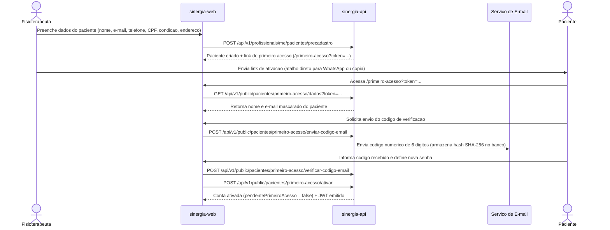

# Fluxo de Autenticação, Perfis de Acesso e Onboarding de Usuários

**Escopo:** Controle de acesso (RBAC), convites, código público de paciente e fluxos de primeiro acesso  
**Repositórios:** `sinergia-api` e `sinergia-web`

---

## 1. Visão Geral e Perfis de Acesso (RBAC)

O controle de autenticação do Sinergia utiliza tokens JWT (`Bearer`) emitidos pela `sinergia-api` e gerenciados no frontend por interceptores HTTP (`auth-token.interceptor.ts`). A tabela `usuario` utiliza herança por coluna discriminadora (`tipo_usuario`) para especializar quatro perfis de acesso:

| Perfil (`tipo_usuario`) | Entidade JPA | Escopo de Atuação no Sistema |
|---|---|---|
| `ADMIN_SISTEMA` | `AdminSistema` | Gerencia o catálogo global de exercícios, mídias e áudios TTS, cadastra clínicas (`Empresa`), vincula profissionais/recepcionistas às clínicas, audita eventos globais e monitora métricas da plataforma. |
| `PROFISSIONAL_SAUDE` | `ProfissionalSaude` | Cadastra e acompanha pacientes sob sua tutela, cria instâncias personalizadas de exercícios, prescreve roteiros, avalia sessões e vídeos, gerencia agenda, conversa pelo chat e acompanha alertas de retenção. Quando possui a flag `administradorEmpresa = true`, acessa também o painel gerencial da clínica, configurações de alertas/lembretes e gestão de recepcionistas. |
| `RECEPCIONISTA` | `Recepcionista` | Atua vinculada a uma clínica ou a profissionais específicos para operação da agenda compartilhada e consulta cadastral de pacientes da carteira. |
| `PACIENTE` | `Paciente` | Acessa seus roteiros prescritos, executa sessões de exercícios com câmera (tempo real ou gravação), visualiza resultados e evolução biomecânica, gerencia agendamentos, troca mensagens com seu fisioterapeuta e controla seus termos de consentimento LGPD. |

---

## 2. Formas de Entrada e Vínculo do Paciente

Um paciente pode ingressar na plataforma e ser vinculado a um fisioterapeuta por três caminhos distintos. Em todos os cenários, cada paciente possui um **código público imutável** (exibido no formato `@AB12CD34EF`, gerado por `PacienteCodigoPublicoGenerator`) e pode estar vinculado a **no máximo um profissional de saúde por vez**.

```mermaid
flowchart TD
    subgraph Caminho1["1. Pre-cadastro pelo Fisioterapeuta (Fluxo Principal Clinico)"]
        P1["Fisioterapeuta preenche pre-cadastro do paciente<br/>POST /api/v1/profissionais/me/pacientes/precadastro"]
        P2["API cria Paciente com pendentePrimeiroAcesso = true<br/>Gera token de primeiro acesso e retorna link de ativacao"]
        P3["Fisioterapeuta envia link por WhatsApp ou e-mail ao paciente"]
        P4["Paciente abre /primeiro-acesso, valida codigo enviado ao e-mail<br/>e define sua senha definitiva"]
        P1 --> P2 --> P3 --> P4
    end

    subgraph Caminho2["2. Auto-registro com Codigo de Convite"]
        C1["Fisioterapeuta gera codigo de convite<br/>POST /api/v1/profissionais/me/convites"]
        C2["Paciente acessa /register e informa codigo de convite<br/>GET /api/v1/public/convites/{codigo}/validar"]
        C3["POST /api/v1/auth/registro cria conta ja vinculada ao profissional"]
        C1 --> C2 --> C3
    end

    subgraph Caminho3["3. Conta Existente Vinculada por Codigo Publico"]
        V1["Paciente cria conta sem convite (ou foi desvinculado anteriormente)"]
        V2["Paciente compartilha seu @codigo_publico exibido no perfil"]
        V3["Fisioterapeuta vincula paciente<br/>POST /api/v1/profissionais/me/pacientes/vincular-por-codigo-publico"]
        V1 --> V2 --> V3
    end
```

### Regras de Negócio de Vínculo e Transferência de Tutela
1. **Unicidade de vínculo ativo:** Se um paciente já possui `profissional_id` preenchido, qualquer tentativa de outro profissional vinculá-lo retorna erro de conflito.
2. **Remoção de vínculo:** O vínculo atual só pode ser encerrado pelo próprio profissional titular (`DELETE /api/v1/profissionais/me/pacientes/{pacienteId}/vinculo`) ou pelo Administrador do Sistema (`DELETE /api/v1/admin/pacientes/{pacienteId}/vinculo`). O paciente não remove o próprio vínculo diretamente pela interface.

---

## 3. Fluxo Detalhado de Primeiro Acesso do Paciente

Quando o fisioterapeuta cadastra o paciente na clínica (modal `patient-onboarding-modal.component.ts` ou página `professional-patient-onboarding.component.ts`), o paciente ainda não possui senha definida (`pendentePrimeiroAcesso = true`).

### Período de Graça Pós-Ativação (`PacienteAtividadeGraceService`)
Para evitar que um paciente recém-ativado receba alertas de inatividade ou cobranças de rotina no mesmo dia em que ativou a conta, a API registra o instante de conclusão do primeiro acesso e aplica um período de graça (`emPeriodoGracaPosPrimeiroAcesso`), durante o qual as tarefas agendadas (`EngagementReminderTask`) suprimem lembretes automáticos para aquele paciente.

---

## 4. Primeiro Acesso do Profissional de Saúde

Profissionais de saúde não se auto-registram publicamente. Eles são cadastrados pelo Administrador do Sistema dentro de uma clínica (`POST /api/v1/admin/empresas/{empresaId}/profissionais`).

1. Ao criar o profissional sem senha definitiva, a API gera um `ProfissionalPrimeiroAcessoToken` (migration `V34__profissional_primeiro_acesso_token.sql`) e envia o link de ativação por e-mail.
2. O profissional acessa a tela `primeiro-acesso-profissional.component.ts`, que consulta `GET /api/v1/profissionais-public/primeiro-acesso?token=...`.
3. O profissional confirma seus dados, define a senha via `POST /api/v1/profissionais-public/primeiro-acesso/ativar` e passa a acessar o painel clínico.

---

## 5. Recuperação e Alteração de Senha

O controlador `RecuperacaoSenhaController` (`/api/v1/auth/senha`) atende tanto usuários deslogados que esqueceram a senha quanto usuários autenticados que desejam alterá-la:

| Fluxo | Endpoint de Solicitação | Endpoint de Conclusão | Comportamento |
|---|---|---|---|
| **Esqueci minha senha** | `POST /api/v1/auth/senha/recuperacao/solicitar` | `POST /api/v1/auth/senha/recuperacao/concluir` | Gera `SenhaResetToken` de uso único com expiração curta e envia link para `/redefinir-senha`. |
| **Alteração de senha** | `POST /api/v1/auth/senha/alteracao/solicitar` | `POST /api/v1/auth/senha/alteracao/concluir` | Exige validação do token enviado ao e-mail do usuário antes de gravar o novo hash BCrypt. |

---

## 6. Referência Rápida de Arquivos

| Camada | Arquivos Principais |
|---|---|
| **Backend (`sinergia-api`)** | `AuthController.java`, `AuthService.java`, `PacientePrimeiroAcessoPublicController.java`, `PacientePrimeiroAcessoPublicService.java`, `ProfissionalPrimeiroAcessoPublicController.java`, `ConviteVinculoService.java`, `RecuperacaoSenhaService.java`, `PacienteAtividadeGraceService.java` |
| **Frontend (`sinergia-web`)** | `features/auth/pages/login/`, `features/auth/pages/register/`, `features/auth/pages/patient-activation/`, `features/auth/pages/primeiro-acesso-profissional/`, `features/auth/pages/esqueci-senha/`, `features/auth/pages/redefinir-senha/`, `features/professional/pages/professional-patient-onboarding/` |
