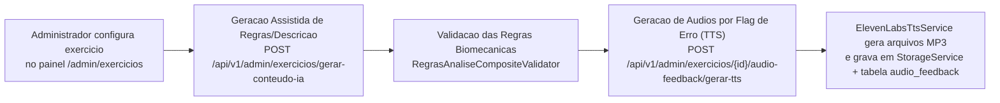
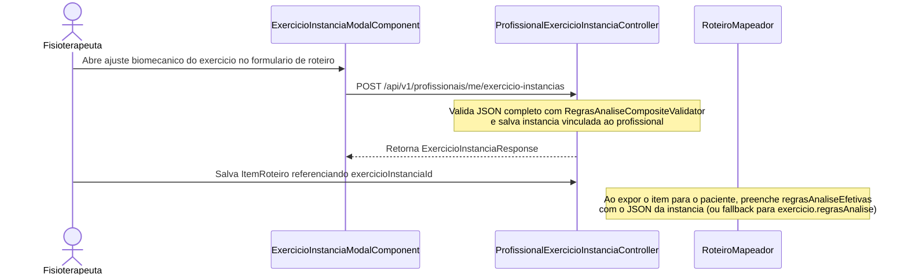

# Fluxo do Catálogo de Exercícios, Instâncias Personalizadas e Síntese de Voz (TTS)

**Escopo:** Ciclo de vida do catálogo de exercícios, validação de regras JSON, controle de visibilidade, geração de conteúdo e áudio via IA e instâncias customizadas por fisioterapeuta  
**Repositórios:** `sinergia-api` e `sinergia-web`

---

## 1. Catálogo Oficial e Carga Inicial (`ExercicioCatalogoSeeder`)

No arranque da `sinergia-api`, o componente `ExercicioCatalogoSeeder` lê todos os arquivos `src/main/resources/seed/exercicios/*.json` e realiza o *upsert* idempotente na tabela `exercicio` utilizando o UUID fixo de cada arquivo.

### Arquétipos de Regras de Análise (`regras_analise`)
O campo `regras_analise` armazena a especificação biomecânica consumida tanto pelo motor em tempo real no navegador quanto pelo reprocessador Java (`LandmarksReplayer`). O validador composto (`RegrasAnaliseCompositeValidator`) delega a validação estrutural no boot e no cadastro conforme a modalidade do exercício:

| Modalidade | Validador Backend | Exemplo no Catálogo | Parâmetros Principais |
|---|---|---|---|
| **Repetição Dinâmica** (`repeticao` / padrão) | `RepeticaoRegrasValidator` | Agachamento, Ponte de Glúteos, Flexão na Parede | `pontos_interesse`, objeto `contagem` (3 landmarks em `UPPER_SNAKE_CASE`, ângulos `min` e `max`) e lista de `erros` (`angulo`, `eixo_x_direcional`, `eixo_y`, `eixo_x_medial`) avaliados por fase (`ESPERANDO`, `DESCENDO`, `SUBINDO`). |
| **Postura Estática Isométrica** (`estatico`) | `EstaticoRegrasValidator` | Escala de Berg 02 (Em pé), Berg 03 (Sentado), Berg 07 (Pés juntos) | `tempo_alvo_segundos`, `tempo_calibracao_ms`, `tolerancia_angular_graus`, perfil postural e faixas de pontuação clínica. |
| **Deslocamento e Alcance** (`deslocamento`) | `DeslocamentoRegrasValidator` | Escala de Berg 08 (Alcançar à frente) | Calibração antropométrica espacial, cálculo de deslocamento horizontal em centímetros e detecção de passo compensatório. |

---

## 2. Controle de Visibilidade por Clínica e Status Beta

A migration `V35__exercicio_visibilidade.sql` introduziu governança sobre quais clínicas podem prescrever cada exercício do catálogo:

- `emBeta` (` boolean`): sinaliza na interface se o exercício ainda está em fase de validação clínica controlada.
- `visivelTodasEmpresas` (`boolean`): quando `true`, o exercício fica disponível para todos os profissionais da plataforma.
- `empresasVisiveis` (tabela associativa `exercicio_empresa`): quando `visivelTodasEmpresas = false`, apenas os profissionais pertencentes às clínicas explicitamente associadas podem visualizar e prescrever o exercício (`PUT /api/v1/admin/exercicios/{id}/visibilidade`).

---

## 3. Ferramentas Administrativas de IA e Síntese de Voz (ElevenLabs TTS)

Na tela `admin-exercicio-form.component.ts`, o Administrador do Sistema dispõe de automações integradas ao `AdminExercicioController`:

### Funcionamento do Mapa de Áudio por Flag (`AudioFeedback`)
1. Cada regra de erro dentro de `regras_analise.erros[]` possui um identificador textual no campo `flag` (por exemplo, `"Valgo dinâmico (joelho caindo para dentro)"`).
2. A tabela `audio_feedback` (migrations `V19` e `V20`) armazena múltiplas variações de áudio (`variacao = 1, 2, 3...`) associadas à tupla `(exercicio_id, feedback_flag)`.
3. Quando o paciente inicia uma sessão, o serviço `FeedbackAudioService` no Angular chama `GET /api/v1/exercicios/{id}/audio-feedback` e faz o pré-carregamento (cache HTTP) dos arquivos de áudio para reprodução imediata sem latência de rede.

---

## 4. Instâncias Personalizadas por Fisioterapeuta (`ExercicioInstancia`)

Pacientes idosos, pós-operatórios ou neurológicos frequentemente necessitam de amplitudes angulares adaptadas (por exemplo, um agachamento que considere válida a flexão até 115 graus em vez de 95 graus). Para que o fisioterapeuta ajuste esses parâmetros sem alterar o catálogo global, existe a entidade `ExercicioInstancia` (migration `V18__exercicio_instancia.sql`).

### Regras de Resolução (`regrasAnaliseEfetivas`)
- A instância armazena o documento JSON completo já resolvido.
- Sempre que a API retorna um item de roteiro para o aplicativo do paciente (`RoteiroMapeador#regrasAnaliseEfetivas`), ela verifica se `itemRoteiro.getExercicioInstancia()` está presente; em caso afirmativo, entrega o JSON da instância; caso contrário, entrega o JSON padrão do exercício base.
- Uma instância não pode ser excluída fisicamente enquanto estiver referenciada por algum item de roteiro ativo.

---

## 5. Referência Rápida de Arquivos

| Camada | Arquivos Principais |
|---|---|
| **Backend (`sinergia-api`)** | `Exercicio.java`, `ExercicioInstancia.java`, `AudioFeedback.java`, `ExercicioCatalogoSeeder.java`, `AdminExercicioController.java`, `ProfissionalExercicioInstanciaController.java`, `ExercicioInstanciaService.java`, `ExercicioIaConteudoService.java`, `ElevenLabsTtsService.java`, `AudioFeedbackService.java`, `RegrasAnaliseCompositeValidator.java` |
| **Frontend (`sinergia-web`)** | `features/admin/pages/admin-exercicios/`, `features/admin/pages/admin-exercicio-form/`, `features/professional/components/exercicio-instancia-modal/`, `core/audio/feedback-audio.service.ts` |
