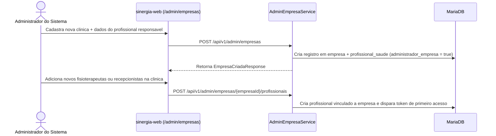

# Fluxo de Gestão Multi-tenant de Clínicas, Equipe e Auditoria

**Escopo:** Administração de empresas (clínicas), vínculo de profissionais e recepcionistas, governança da clínica e trilha de auditoria  
**Repositórios:** `sinergia-api` e `sinergia-web`

---

## 1. Modelo Multi-tenant de Clínicas (`Empresa`)

O Sinergia organiza profissionais de saúde, recepcionistas e carteiras de pacientes sob o conceito de **Empresa** (clínica ou consultório). O isolamento lógico garante que profissionais e recepcionistas acessem exclusivamente informações pertencentes à sua clínica e aos pacientes vinculados.

### Papéis dentro de uma Clínica
1. **Profissional Gestor (`ProfissionalSaude` com `administradorEmpresa = true`):**
   - Criado no momento da fundação da empresa pelo Administrador do Sistema ou promovido posteriormente.
   - Além de atender seus próprios pacientes, possui acesso ao painel consolidado da clínica (`/profissional/empresa`), configuração de políticas de lembretes e alertas clínicos da empresa, exportação de relatórios gerenciais e gerenciamento de recepcionistas.
2. **Profissional Clínico (`ProfissionalSaude` com `administradorEmpresa = false`):**
   - Gerencia sua carteira individual de pacientes, roteiros, instâncias de exercícios, sessões e agenda.
3. **Recepcionista (`Recepcionista`):**
   - Vinculada a uma empresa e a um conjunto de profissionais de saúde (`recepcionista_profissional`, migration `V16__perfil_recepcionista_e_vinculos.sql`).
   - Opera a agenda dos profissionais vinculados e consulta dados cadastrais básicos dos pacientes para suporte ao atendimento.

---

## 2. Fluxo de Criação e Administração de Clínicas (Visão Admin Sistema)

O Administrador do Sistema gerencia o ciclo de vida das clínicas através das telas `admin-empresas.component.ts` e `admin-empresa-detalhe.component.ts`, consumindo `AdminController` (`/api/v1/admin`):

### Principais Endpoints Administrativos de Empresas
| Método e Rota | Descrição |
|---|---|
| `GET /api/v1/admin/dashboard` | Indicadores globais da plataforma (total de empresas, profissionais, pacientes, sessões e saúde do serviço de e-mail). |
| `GET /api/v1/admin/empresas` | Lista todas as clínicas cadastradas com métricas resumidas. |
| `POST /api/v1/admin/empresas` | Cria uma nova clínica juntamente com seu profissional responsável. |
| `PUT /api/v1/admin/empresas/{empresaId}` | Atualiza dados cadastrais e status da clínica. |
| `POST /api/v1/admin/empresas/{empresaId}/profissionais` | Vincula um novo fisioterapeuta à clínica. |
| `POST /api/v1/admin/empresas/{empresaId}/recepcionistas` | Cadastra recepcionista vinculada à clínica. |

---

## 3. Painel Gerencial da Clínica e Parametrizações Clínicas

O fisioterapeuta gestor da clínica acessa `professional-empresa-dashboard.component.ts`, alimentado por `EmpresaDashboardService` e `RelatorioEmpresaService`:

1. **Indicadores Consolidados (`GET /api/v1/profissionais/me/empresa/dashboard`):**
   - Volume de pacientes ativos da clínica, taxa média de adesão aos roteiros, total de sessões realizadas no período, distribuição por profissional e pacientes em faixa de atenção.
2. **Governança de Lembretes Automáticos (`PATCH /api/v1/profissionais/me/empresa/lembretes`):**
   - Habilita ou desabilita globalmente os lembretes automáticos para toda a clínica (`empresa.lembretesAutomaticosHabilitados`, migration `V30__lembrete_preferencias.sql`).
   - Cada profissional também pode refinar suas preferências individuais em `PATCH /api/v1/profissionais/me/lembretes` (`lembretesExerciciosHabilitados`, `lembretesInatividadeHabilitados`, `lembretesAgendaHabilitados`).
3. **Parametrização de Alertas Clínicos (`PATCH /api/v1/profissionais/me/empresa/alertas-clinicos`):**
   - Configura se os alertas clínicos automáticos estão ativos na clínica e define os limiares institucionais (migration `V32__empresa_alertas_clinicos_config.sql`):
     - `limiarQuedaPontuacaoClinica`: queda percentual ou absoluta de precisão entre a sessão anterior e a atual que dispara alerta ao fisioterapeuta (padrão: `15.0` pontos).
     - `sessoesErroRecorrenteAlerta`: quantidade de sessões consecutivas com a mesma falha biomecânica para disparar alerta de erro recorrente (padrão: `3` sessões).
4. **Gestão de Recepcionistas pelo Profissional (`ProfissionalRecepcionistaService`):**
   - Endpoints em `/api/v1/profissionais/me/recepcionistas` (`GET`, `POST`, `PATCH`, `DELETE`) permitem cadastrar recepcionistas, validar CPF (`V26__recepcionista_cpf.sql`) e definir quais agendas de profissionais aquela recepcionista pode operar.

---

## 4. Trilha de Auditoria (`AuditLog`)

Para atender aos requisitos de segurança da informação e prestação de contas da LGPD (migrations `V28__audit_log.sql` e `V31__empresa_alertas_e_audit_empresa.sql`), o serviço `AuditService` registra acessos e operações sensíveis:

- **Eventos rastreados:** visualização de resultados de análises biomecânicas, consulta de estatísticas e evolução do paciente, exportação de relatórios clínicos (PDF/CSV), alterações de configuração da empresa e ações administrativas.
- **Consulta da trilha de auditoria:**
  - **Visão do Gestor da Clínica:** `GET /api/v1/profissionais/me/empresa/auditoria` exibe os eventos realizados pelos colaboradores da própria empresa.
  - **Visão do Administrador do Sistema:** `GET /api/v1/admin/auditoria` permite auditar eventos em toda a plataforma com filtros por tipo de ação, usuário e período.

---

## 5. Referência Rápida de Arquivos

| Camada | Arquivos Principais |
|---|---|
| **Backend (`sinergia-api`)** | `Empresa.java`, `AdminController.java`, `AdminEmpresaService.java`, `EmpresaDashboardService.java`, `ProfissionalRecepcionistaService.java`, `RecepcionistaService.java`, `AuditLog.java`, `AuditService.java`, `AuditConsultaService.java`, `RelatorioEmpresaService.java` |
| **Frontend (`sinergia-web`)** | `features/admin/pages/admin-dashboard/`, `features/admin/pages/admin-empresas/`, `features/admin/pages/admin-empresa-detalhe/`, `features/professional/pages/professional-empresa-dashboard/`, `features/professional/pages/professional-receptionists/`, `features/recepcionista/` |
