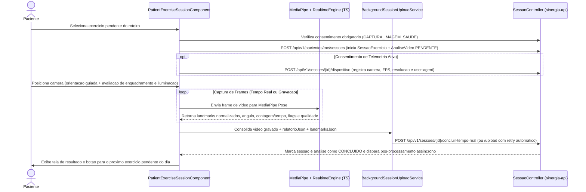

# Fluxo de Prescrição de Roteiros, Execução de Sessão e Processamento de Análise

**Escopo:** Modelagem de roteiros terapêuticos, captura e avaliação biomecânica no navegador, upload resiliente, pós-processamento com Gemini, materialização e reprocessamento de landmarks  
**Repositórios:** `sinergia-api` e `sinergia-web`

---

## 1. Prescrição e Ciclo de Vida de Roteiros Terapêuticos

O fisioterapeuta prescreve o plano de reabilitação do paciente por meio da entidade `Roteiro` e de sua lista ordenada de `ItemRoteiro` (`professional-roteiro-form.component.ts` e `ProfissionalRoteiroService`):

- **Atributos de `Roteiro`:** título, descrição clínica, status `ativo` e vínculo com `Paciente` e `ProfissionalSaude`. Cada paciente possui no máximo um roteiro ativo por vez; ao atribuir ou substituir um roteiro (`POST /api/v1/profissionais/me/pacientes/{pacienteId}/roteiros/{roteiroId}/substituir`), o roteiro anterior é desativado preservando todo o histórico de sessões.
- **Atributos de `ItemRoteiro`:**
  - `exercicio` (obrigatório) e `exercicioInstancia` (opcional, quando o profissional personalizou ângulos ou regras para aquele paciente).
  - `ordem`, `series`, `repeticoes` e `descansoSegundos` (migration `V21__item_roteiro_descanso.sql`).
  - `diasSemana` (ex.: `"SEG,QUA,SEX"`, migration `V27__roteiro_sessao_config.sql`): determina em quais dias da semana o exercício é exigido na rotina diária do paciente (`RoteiroSessaoService#itensAgendadosParaDia`).
  - `observacoes` (instruções exibidas ao paciente antes da execução) e `notaProfissional` (anotação clínica privada/técnica usada no contexto do relatório e da IA, migration `V11__item_roteiro_nota_profissional.sql`).

---

## 2. Pipeline de Execução da Sessão no Cliente (`sinergia-web`)

A execução de um exercício ocorre no componente `patient-exercise-session.component.ts` e segue cinco etapas encadeadas:



### 2.1. Qualidade de Captura e Confiança da Análise
Antes e durante a execução, os utilitários `capture-quality.util.ts` e `capture-quality-tracker.ts` monitoram a visibilidade das articulações de interesse, a distância do corpo em relação ao quadro, a estabilidade e a luminosidade. Ao final da sessão, o relatório incorpora o bloco `qualidade_captura`:
```json
{
  "qualidade_captura": {
    "score": 85,
    "confianca_analise": 0.92,
    "frames_ok": 460,
    "frames_total": 500,
    "avisos": []
  },
  "confianca_analise": 0.92
}
```

### 2.2. Persistência Local e Upload Resiliente em Segundo Plano
Para evitar perda de sessão em conexões móveis instáveis, `session-persistence.service.ts` e `background-session-upload.service.ts` gerenciam a fila de envio do arquivo de vídeo (`video`), do relatório estruturado (`relatorioJson`) e da série temporal de coordenadas (`landmarksJson`), realizando até 3 tentativas automáticas com *backoff* em caso de falha de rede.

---

## 3. Processamento na API, Enriquecimento via Gemini e Materialização

Quando o endpoint `POST /api/v1/sessoes/{id}/concluir-tempo-real` ou `POST /api/v1/sessoes/{id}/upload` recebe os dados da sessão (`SessaoAnaliseConclusaoService` e `UploadSessaoService`):

1. **Gravação Imediata:**
   - O arquivo de vídeo é armazenado via `StorageService` em `./uploads/sections/{analiseId}/`.
   - A entidade `AnaliseVideo` recebe `relatorioJson`, `landmarksJson` (migration `V33__analise_landmarks_e_resultado_materializado.sql`) e passa para `statusAnalise = CONCLUIDO`.
   - O fisioterapeuta responsável recebe uma notificação imediata (`TipoNotificacao.SESSAO_CONCLUIDA`) e os detectores de alerta clínico (`ClinicoAlertaService`) verificam se houve queda abrupta de pontuação ou erro recorrente.

2. **Pós-processamento Assíncrono (`AnalisePosProcessamentoAsyncService`):**
   - Executado em *background* (`@Async`) logo após o commit da conclusão da sessão:
     - `ClinicalContextBuilder` reúne o contexto longitudinal do paciente (nome do exercício, `notaProfissional` do item de roteiro, precisão das sessões anteriores e score de qualidade da captura).
     - `GeminiFeedbackService` gera dois textos distintos a partir dos dados reais da sessão:
       - `resumo_paciente`: parágrafo curto, motivador e sem jargão técnico, destacando um acerto e no máximo uma dica prática de correção postural.
       - `resumo_clinico`: síntese técnica objetiva para o fisioterapeuta, relacionando pontuação, frequência de flags biomecânicas, comparação com a sessão anterior e confiabilidade da captura.
     - `AnaliseResultadoMaterializacaoService` monta o DTO completo `AnaliseResultadoResponse` e grava sua representação serializada na coluna `analise_video.resultado_materializado`.

3. **Leitura Rápida e Polling na Tela de Resultado (`AnaliseController#resultado`):**
   - A tela `exercise-result-page.component.ts` consulta `GET /api/v1/analises/{id}/resultado`.
   - Enquanto `posProcessamentoConcluido = false`, a tela exibe imediatamente as métricas determinísticas, o vídeo com marcadores de erro na barra de progresso (`flagsRanges` e `flagsTimeline`) e realiza *polling* leve até que os resumos enriquecidos e o cache materializado estejam disponíveis.

---

## 4. Reprocessamento Determinístico de Landmarks (`LandmarksReplayer`)

Se o fisioterapeuta ou administrador ajustar as regras angulares de um exercício ou instância após o paciente já ter realizado a sessão, não é necessário reenviar nem reprocessar o arquivo de vídeo:

1. O profissional aciona o botão **Reprocessar regras** na tela de resultado (`POST /api/v1/analises/{id}/reprocessar`).
2. `LandmarksReprocessService` carrega a série temporal salva em `analise_video.landmarks_json` e as regras vigentes (`regrasAnaliseEfetivas`).
3. `LandmarksReplayer` executa quadro a quadro `LandmarksFrameEngine`, `RepCounter` e `RuleEvaluatorEngine` em Java, recalcula repetições, ângulos mínimos, linha do tempo de flags e pontuação, atualiza `relatorio_json` e dispara novamente a materialização do resultado.

---

## 5. Referência Rápida de Arquivos

| Camada | Arquivos Principais |
|---|---|
| **Backend (`sinergia-api`)** | `RoteiroController.java`, `ProfissionalRoteiroService.java`, `RoteiroSessaoService.java`, `SessaoController.java`, `SessaoAnaliseConclusaoService.java`, `UploadSessaoService.java`, `AnaliseController.java`, `AnaliseResultadoService.java`, `AnalisePosProcessamentoService.java`, `AnaliseResultadoMaterializacaoService.java`, `ClinicalContextBuilder.java`, `GeminiFeedbackService.java`, `LandmarksReplayer.java`, `LandmarksReprocessService.java` |
| **Frontend (`sinergia-web`)** | `features/professional/pages/professional-roteiro-form/`, `features/patient/pages/patient-exercises/`, `features/patient/pages/patient-exercise-session/`, `core/realtime/`, `core/sync/background-session-upload.service.ts`, `features/shared/pages/exercise-result-page/` |
