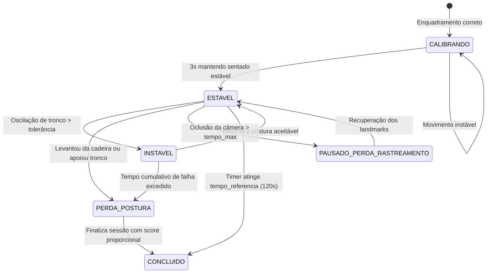

# Documentação Técnica: Exercício 3 da Escala de Berg no Sinergia
## Permanecer Sentado sem Apoio nas Costas com os Pés Apoiados

---

## 1. Visão Geral e Contexto Clínico

### Descrição do Teste
- **Nome Oficial:** Exercício 3 — Permanecer sentado sem apoio nas costas, mas com os pés apoiados no chão ou num banquinho por até 2 minutos (120 segundos).
- **Objetivo Clínico:** Avaliar o controle postural estático na posição sentada e a estabilidade de tronco sem apoio posterior (encosto) ou dos membros superiores.
- **Orientações ao Paciente:** "Fique sentado com os braços cruzados por 2 minutos."
- **Critérios Oficiais de Pontuação (Berg Balance Scale):**
  - **Score 4:** Capaz de permanecer sentado com segurança e com postura estável por 2 minutos (120 segundos).
  - **Score 3:** Capaz de permanecer sentado por 2 minutos sob supervisão.
  - **Score 2:** Capaz de permanecer sentado por 30 segundos.
  - **Score 1:** Capaz de permanecer sentado por 10 segundos.
  - **Score 0:** Incapaz de permanecer sentado sem apoio por 10 segundos.

### Diretrizes e Esclarecimentos Clínicos (Alinhamento com Especialistas)
1. **Braços Cruzados como Orientação (Não Bloqueante):**
   - Na reunião com João e Juvanir, esclareceu-se que a instrução de cruzar os braços é uma **orientação funcional** para desencorajar o paciente de usar os membros superiores para sustentar o tronco (apoiar as mãos na cadeira, pernas ou mesa).
   - **Não deve ser um requisito rígido de execução:** Se o paciente descruzar os braços para manter equilíbrio ou se tiver restrição motora/dor no ombro, o teste **não é cancelado nem invalidado** por isso.
   - O sistema detecta a postura dos braços e registra o percentual de tempo com braços cruzados (`pct_tempo_bracos_cruzados`) e sinaliza na UI de forma sutil e não impeditiva.
2. **Foco Principal na Estabilidade de Tronco:**
   - O objetivo primordial é monitorar oscilações excessivas no plano sagital (flexão excessiva à frente ou apoio no encosto atrás) e a manutenção da geometria sentada com pés apoiados.
3. **Visão Computacional como Sugestor Objetivo (Sem Substituição Clínica):**
   - A inteligência artificial / visão computacional do Sinergia atua estritamente como **Sugeridor de Score Baseado em Cinemática** (`score_sugerido`), gerando métricas numéricas objetivas e flags contextuais (`perda_postura_detectada`, `possivel_apoio_maos`, `oscilacao_tronco_graus`).
   - A pontuação final é sempre validada pelo profissional de saúde (`therapist_validated_score`).

---

## 2. Visão Computacional e Cinemática 2D

### Posicionamento e Enquadramento da Câmera
- **Plano de Visão:** **Sagital (Perfil / Vista Lateral)**.
  - O perfil lateral é geometricamente indispensável para observar:
    - O ângulo de inclinação do tronco em relação à vertical;
    - A flexão do quadril e dos joelhos (~90° na posição sentada padrão);
    - A separação entre as costas e o encosto da cadeira;
    - A posição das mãos e pulsos em relação ao assento.
- **Orientação:** Paisagem ou Retrato (com corpo inteiro visível da cabeça aos pés, incluindo a cadeira e o chão).
- **Distância recomendada:** ~1.8 a 2.5 metros da cadeira.

### Articulações e Keypoints Monitorados
- **Tronco e Eixo Sagital:**
  - `NOSE` / `EAR` (referência cefálica)
  - `SHOULDER` (espectro sagital: ombro do lado visível)
  - `HIP` (ponto de rotação do tronco e pelve)
- **Membros Inferiores (Confirmação de Posição Sentada e Apoio dos Pés):**
  - `KNEE` (flexão do joelho)
  - `ANKLE` (tornozelo)
  - `HEEL` e `FOOT_INDEX` (estabilidade da base de apoio no solo)
- **Membros Superiores (Detecção de Braços Cruzados e Apoio de Mãos):**
  - `ELBOW` (cotovelos)
  - `WRIST` (pulsos)

### Critérios Geométricos e Heurísticas Implementadas
1. **Confirmação de Postura Sentada:**
   - Eixo coxa (`HIP` -> `KNEE`): inclinação próxima da horizontal (`|dy / dx| < 1.15`).
   - Flexão de joelho (`HIP` - `KNEE` - `ANKLE`): entre 50° e 140° (típico sentado 75°-110°).
   - Quando o joelho estende além de 145° ou a coxa fica vertical, o sistema detecta que o paciente levantou da cadeira (`PERDA_POSTURA`).
2. **Estabilidade de Tronco (Sagital):**
   - Ângulo do tronco (`HIP` -> `SHOULDER`) comparado com a vertical calibrada no baseline.
   - Tolerância angular configurável (padrão 12° a 15°).
   - Cálculo de desvio médio e máximo de oscilação do tronco em graus.
3. **Travamento da Direção Facial (`frenteDir`):**
   - A direção que o paciente está olhando (direita `+1` ou esquerda `-1`) é travada durante a fase de calibração baseline.
   - Isso impede erros de inversão matemática caso o paciente recline o tronco para trás e a coordenada X do nariz passe atrás da coordenada X do quadril.
4. **Detecção Heurística de Apoio de Mãos:**
   - Se os pulsos estiverem posicionados abaixo do quadril e imóveis em relação ao assento por tempo prolongado, a flag `possivel_apoio_maos` é registrada para revisão do terapeuta.
5. **Braços Cruzados (Orientação Não Bloqueante):**
   - Calculada pela proximidade cruzada dos pulsos aos cotovelos contralaterais e proximidade ao tronco anterior.
   - Se `false`, o cronômetro de permanência sentado **continua rodando normalmente**, apenas atualizando a métrica `pct_tempo_bracos_cruzados`.

---

## 3. Máquina de Estados e Transições

O motor opera na máquina de estados desacoplada:



- **Tempo Válido vs Tempo Contínuo:**
  - `tempo_valido_ms`: Tempo total em que a postura atendeu aos critérios de estabilidade.
  - `tempo_continuo_ms`: Maior bloco contínuo ininterrupto de permanência estável.
  - A pontuação de Berg utiliza o tempo de estabilidade para inferir a faixa alcançada.

---

## 4. Mapeamento Dinâmico de Pontuação (Faixas de Score)

O cálculo de pontuação não possui números mágicos hardcoded. Ele consome o array `faixas_score` definido na configuração do exercício:

```json
"faixas_score": [
  { "score": 4, "tempo_minimo_segundos": 120, "descricao": "Permaneceu sentado com segurança por 2 minutos" },
  { "score": 3, "tempo_minimo_segundos": 120, "requer_supervisao": true, "descricao": "Permaneceu 2 minutos sob supervisão" },
  { "score": 2, "tempo_minimo_segundos": 30, "descricao": "Capaz de permanecer sentado por 30 segundos" },
  { "score": 1, "tempo_minimo_segundos": 10, "descricao": "Capaz de permanecer sentado por 10 segundos" },
  { "score": 0, "tempo_minimo_segundos": 0, "descricao": "Incapaz de permanecer sentado sem apoio por 10 segundos" }
]
```

O motor sugere a pontuação com base no tempo atingido:
- `tempo >= 120s` -> Sugere **Score 4** (ou nota de supervisão para o terapeuta avaliar se enquadra em 3).
- `30s <= tempo < 120s` -> Sugere **Score 2**.
- `10s <= tempo < 30s` -> Sugere **Score 1**.
- `tempo < 10s` -> Sugere **Score 0**.

---

## 5. Arquitetura e Desacoplamento do Sistema

A implementação seguiu estritamente o princípio de alta coesão e baixo acoplamento:

### 1. Backend (`sinergia-api`)
- **Papel:** Catálogo, validação de integridade estrutural das regras e persistência de relatórios.
- **Validador Genérico ([RegrasAnaliseValidator.java](file:///d:/Projects/sinergia-api/src/main/java/com/sinergia/api/domain/analise/RegrasAnaliseValidator.java)):**
  - Reconhece exercícios estáticos (`tipo: "estatico"` ou `modo: "estatico"`).
  - Valida parâmetros temporais (`tempo_referencia_segundos`) dispensando campos de repetição como `contagem`.
- **Seed Oficial ([berg-03-permanecer-sentado.json](file:///d:/Projects/sinergia-api/src/main/resources/seed/exercicios/berg-03-permanecer-sentado.json)):**
  - UUID `b0000000-0000-4000-8000-000000000003`.
  - Configuração de câmera sagital, tolerâncias e faixas de score.

### 2. Frontend Realtime Engine (`sinergia-web`)
- **Padrão Strategy ([PostureProfile](file:///d:/Projects/sinergia-web/libs/realtime-engine/src/posture-profiles/posture-profile.ts)):**
  - O motor [StaticPostureEngine](file:///d:/Projects/sinergia-web/libs/realtime-engine/src/static-posture-engine.ts) delega as especificidades biomecânicas para perfis dedicados:
    - `EmPeSagitalProfile`: Exercício 2 (Em pé, perfil sagital).
    - `EmPeFrontalProfile`: Exercício 7 (Em pé com pés juntos, frontal).
    - `SentadoSagitalProfile`: Exercício 3 (Sentado sem apoio, perfil sagital).
  - Elimina condicionais e acoplamento a IDs fixos de exercícios.
- **Normalização e Contratos:**
  - Fixture compartilhado de teste de contrato: [berg-03-sitting-unsupported.json](file:///d:/Projects/sinergia-web/contracts/realtime/fixtures/berg-03-sitting-unsupported.json).
  - Suporta execução idêntica no TypeScript e no worker Python.

### 3. Persistência de Relatório Clínico
- As métricas calculadas em tempo real são salvas na coluna JSON `relatorio_json` da tabela `analise_video`:
  - `tempo_permanencia_segundos`: tempo de permanência estável.
  - `estabilidade_tronco`: média e pico de oscilação do tronco em graus.
  - `bracos_cruzados_pct`: percentual de adesão à orientação dos braços.
  - `flags`: perda de postura, possível apoio de mãos.
  - `berg`: objeto com `score_sugerido` pela IA e campo `therapist_validated_score: null` para preenchimento profissional.

---

## 6. Dúvidas Clínicas e Recomendações para João e Juvanir

1. **Diferenciação entre Score 4 e Score 3:**
   - Na escala Berg, a diferença entre 4 e 3 para 120s é "com segurança" vs "sob supervisão".
   - *Proposta implementada:* A visão computacional pontua 4 se atingir 120s sem perda de postura, mas exibe na tela do terapeuta o toggle "Necessitou de supervisão constante?", que ajusta o score validado para 3 com um clique.
2. **Uso de Banquinho ou Ajuste de Altura dos Pés:**
   - Para pacientes de baixa estatura, os pés podem não tocar o chão se a cadeira for alta. O protocolo da escala Berg permite o uso de um banquinho ou apoio para os pés.
   - *Validação:* Como o sistema monitora a estabilidade relativa tornozelo-joelho-quadril e a imobilidade da base dos pés no plano sagital, o uso de banquinho é perfeitamente suportado sem alterar o algoritmo.
3. **Tolerância a Apoio Posterior Breve:**
   - Se o paciente tocar levemente o encosto por 1 segundo e retomar a postura ereta, deve ser considerado perda imediata do teste ou apenas advertência e dedução de tempo estável?
   - *Comportamento atual:* O sistema usa filtro de média móvel (EMA) e tolerância temporal de 1.5s antes de transicionar para perda de postura definitiva, permitindo pequenas correções posturais voluntárias.
