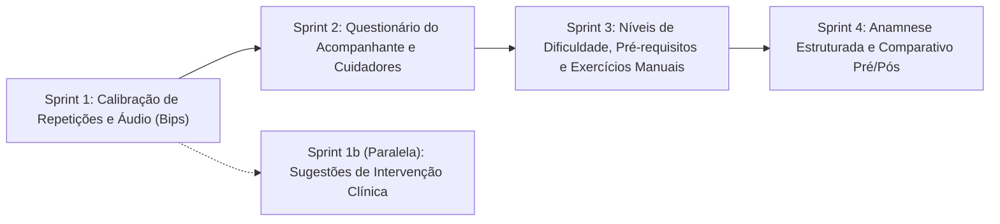

# Plano de Implementação Técnica — Demandas Clínicas e Produto (Reuniões Set–Out/2026)

> **Documento de Especificação Técnica e Guia de Execução por Sprints**  
> **Data de Consolidação:** 10/11/2026  
> **Repositórios Alvo:** `sinergia-api` (Java 21 / Spring Boot 3 / MariaDB / Flyway), `sinergia-web` (Angular / TypeScript / Tailwind CSS)  
> **Escopo Excluído deste Plano:** Catálogo incremental da Escala de Equilíbrio de Berg (Categorias A–E, itens 1 a 14) — já em desenvolvimento paralelo pela equipe ao longo do mês.

---

## 1. Origem e Rastreabilidade das Demandas

| Código | Data | Participantes / Contexto | Documento Fonte |
|---|---|---|---|
| **R0** | 03/09/2026 | Clarissa Cardoso (Profa. UnB), Kairon, Adalberto — Variabilidade motora, sugestões de intervenção e LGPD | [Google Docs — Reunião 03/09](https://docs.google.com/document/d/18ZuqF_4eDgcDFWkR85F0O4czl6MyqKwiYaVcgYzfcLs/edit?tab=t.epssfss9a20y) |
| **R1** | 10/09/2026 | João Victor Veras, Juvanir Nunes, Kairon, Luis Felipe, Adalberto, Wallas — Alinhamento clínico e Parkinson | [Google Docs — Reunião 10/09](https://docs.google.com/document/d/1iLvg8rWA7JBivX7ZCf0A6oJf7ww_tZ9qnuVvk0aOd5I/edit?tab=t.nmwzg67yww9w) |
| **R2** | 02/10/2026 | Equipe Técnica + Consultores Clínicos — Métricas, calibração, acompanhante, níveis de dificuldade e anamnese | [Google Docs — Reunião 02/10](https://docs.google.com/document/d/1p1Jj_JbK_dX1mGKN7IYzRYeUpo_bsCv-mKwAsjubOOI/edit?tab=t.gj6vpprww5w6) |
| **R3** | 27/10/2026 | Equipe Técnica + Consultores Clínicos — Testes práticos, calibração em repetições, bips, cuidadores e exercícios manuais | [Google Docs — Reunião 27/10](https://docs.google.com/document/d/17ykRB4eGU6kEMZXSbpGtYnlMLyUaR2YxaDEFUgoAFkU/edit?tab=t.rjhmx9h95s3d) |

---

## 2. Regras de Engenharia e GitFlow Obrigatórias

Qualquer desenvolvedor ou agente de IA executando uma sprint deste documento **DEVE** seguir rigorosamente as diretrizes de [`AGENTS.md`](../../AGENTS.md):

1. **Branching a partir da `develop` atualizada** (proibido commit/push direto em `develop` ou `master`):
   ```bash
   git checkout develop
   git pull origin develop
   git checkout -b feat/<nome-da-branch>
   ```
2. **Migrations Flyway (`sinergia-api`)**:
   - Última migration existente: `V39__paciente_altura_cm.sql`.
   - **NUNCA** edite migrations já commitadas (`V1` a `V39`). Crie novos arquivos sequenciais (`V40__...`, `V41__...`, etc.) em `src/main/resources/db/migration/`.
3. **Validação Local Obrigatória antes de abrir PR**:
   - **Backend (`sinergia-api`):** `.\mvnw.cmd test`
   - **Frontend (`sinergia-web`):** `npm run test:headless` e `npm run build:homolog`
4. **Pull Request:** sempre apontando para a branch base `develop`.

---

## 3. Visão Geral das Sprints e Arquitetura de Entregas



| Sprint | Funcionalidades Principais | Migration Prevista | Branches Sugeridas (`sinergia-api` / `sinergia-web`) |
|---|---|---|---|
| **S1** | Calibração por repetições (3 teste + 12 livres, baseline individual 3s) + Bips sonoros por padrão (acerto/erro) e toggle de voz | *(Sem migration — evolução de schema JSON `regras_analise`)* | `feat/calibracao-repeticoes`<br>`feat/feedback-sonoro-bips` |
| **S1b** | Sugestões de intervenção prática por flag revisadas por especialistas + reescrita controlada via Gemini | `V40__regras_intervencao_clinica.sql` | `feat/sugestoes-intervencao-relatorio` |
| **S2** | Questionário pós-exercício do acompanhante/cuidador no fluxo do paciente + Cadastro de cuidador e notificações por e-mail | `V41__cuidador_e_questionario_acompanhante.sql` | `feat/questionario-acompanhante`<br>`feat/cuidador-notificacoes` |
| **S3** | Dificuldade (Fácil/Médio/Difícil) atrelada à pontuação + Pré-requisitos opcionais + Exercício manual sem IA (modo gravação/revisão) + Solicitação de exercício | `V42__exercicio_manual_dificuldade_prerequisitos.sql` | `feat/nivel-dificuldade`<br>`feat/exercicio-manual` |
| **S4** | Anamnese clínica estruturada + Média postural por patologia/paciente + Comparativo evolutivo Pré/Pós (janela de 3 meses) | `V43__anamnese_paciente_e_baseline_patologia.sql` | `feat/anamnese-paciente`<br>`feat/comparativo-evolucao` |

---

## 4. Especificação Detalhada por Sprint

---

### SPRINT 1 — Calibração em Exercícios de Repetição e Política de Áudio (Bips)

**Contexto Clínico (R0, R2, R3):**
- Pacientes idosos ou com Doença de Parkinson possuem limitações articulares individuais (cifose, flexão basal de joelho) que não devem invalidar a execução nem gerar avisos verbais intrusivos a cada repetição.
- O sistema deve permitir **calibração inicial nos primeiros 3 segundos** (postura basal) e/ou **3 repetições iniciais de calibração seguidas de 12 repetições livres**, exibindo o relatório consolidado apenas ao final.
- O feedback sonoro padrão durante a execução deve usar **bips diferenciados (acerto vs. erro)** em vez de voz contínua (mantendo a voz pré-gravada/TTS como opção ativável pelo usuário).

#### 4.1.1 Backend (`sinergia-api`)

1. **Contrato JSON `regras_analise` para exercícios de repetição:**
   Adicionar suporte opcional ao bloco `calibracao_repeticao` dentro de `regras_analise`:
   ```json
   {
     "nome": "Agachamento",
     "modo": "repeticao",
     "pontos_interesse": ["LEFT_HIP", "LEFT_KNEE", "LEFT_ANKLE", "LEFT_SHOULDER"],
     "contagem": {
       "landmarks": ["LEFT_HIP", "LEFT_KNEE", "LEFT_ANKLE"],
       "min": 95,
       "max": 160
     },
     "calibracao_repeticao": {
       "habilitada": true,
       "tempo_postura_inicial_ms": 3000,
       "repeticoes_calibracao": 3,
       "repeticoes_livres_alvo": 12,
       "tolerancia_desvio_graus": 5.0,
       "suprimir_feedback_durante_livres": true
     },
     "erros": []
   }
   ```
2. **Validador (`RepeticaoRegrasValidator.java`):**
   - Arquivo: `src/main/java/com/sinergia/api/domain/analise/validator/RepeticaoRegrasValidator.java`
   - Validar o nó opcional `calibracao_repeticao`:
     - `tempo_postura_inicial_ms`: inteiro entre `0` e `15000` (default `3000`).
     - `repeticoes_calibracao`: inteiro entre `0` e `10` (default `3`).
     - `repeticoes_livres_alvo`: inteiro entre `1` e `100` (default `12`).
     - `tolerancia_desvio_graus`: numérico entre `1.0` e `30.0` (default `5.0`).
3. **Motor de Reprocessamento (`ProcessedExerciseConfig.java`, `ExerciseConfigParser.java`, `RepCounter.java`, `LandmarksReplayer.java`):**
   - Em `ProcessedExerciseConfig`: incluir record `CalibracaoRepeticaoConfig(boolean habilitada, int tempoPosturaInicialMs, int repeticoesCalibracao, int repeticoesLivresAlvo, double toleranciaDesvioGraus, boolean suprimirFeedbackDuranteLivres)`.
   - Em `RepCounter.java`:
     - Adicionar suporte a fase de calibração: nas primeiras `N` repetições (`repeticoesCalibracao`), registrar `minAngle` e `maxAngle` alcançados pelo paciente para calcular `baselineMinAngle` (média dos mínimos das repetições de calibração) e `baselineMaxAngle` (média dos máximos).
     - Após concluir as repetições de calibração, ajustar dinamicamente os limiares efetivos caso o paciente tenha amplitude reduzida, respeitando `tolerancia_desvio_graus` (5° padrão definidos na R2), e contabilizar separadamente `calibrationRepsCompleted` e `validRepsCompleted`.
   - Em `LandmarksReplayer.java`:
     - No JSON de relatório gerado (`buildRelatorio`), incluir o objeto `"calibracao"`:
       ```json
       "calibracao": {
         "realizada": true,
         "repeticoes_calibracao": 3,
         "angulo_min_medio_calibrado": 104.5,
         "angulo_max_medio_calibrado": 168.0
       }
       ```

#### 4.1.2 Frontend (`sinergia-web`)

1. **Motor Realtime de Repetição e Coletor (`src/app/core/realtime/`):**
   - Espelhar a lógica de calibração do `RepCounter`:
     - Estados da sessão de repetição quando `calibracao_repeticao.habilitada === true`:
       1. `AGUARDANDO_ENQUADRAMENTO`
       2. `CALIBRANDO_POSTURA_INICIAL` (primeiros `3000ms` medindo ângulo articular basal em pé/inicial)
       3. `CALIBRANDO_REPETICOES` (`1..3` repetições de teste para capturar amplitude funcional do paciente)
       4. `EM_EXECUCAO_LIVRE` (`1..12` repetições livres; erros geram `flags` silenciosas para o relatório final sem interromper a contagem).
2. **HUD de Repetição (`hud-repetition.component.ts` / `.html`):**
   - Exibir badge claro da etapa atual: `"Calibração: Repetição X de 3"` $\rightarrow$ `"Execução Livre: X de 12"`.
3. **Serviço de Áudio (`src/app/core/audio/feedback-audio.service.ts`):**
   - Definir enum/tipo `AudioFeedbackMode = 'BEEP' | 'VOICE' | 'MUTE'`.
   - Persistir preferência no `localStorage` (`sinergia_audio_feedback_mode`), com **valor padrão `'BEEP'`**.
   - Implementar métodos dedicados via Web Audio API (`AudioContext`):
     - `playSuccessBeep()`: tom duplo ascendente curto e agradável (ex.: `660Hz` por `80ms` $\rightarrow$ `880Hz` por `120ms`, `gain = 0.08`) ao completar uma repetição válida.
     - `playWarningBeep()`: tom grave curto não-intrusivo (ex.: `330Hz` por `160ms`, onda `triangle`, `gain = 0.08`) ao fechar uma repetição com flag postural ativa (quando `suprimir_feedback_durante_livres` for `false`) ou ao perder enquadramento.
   - Em `patient-exercise-session.component.ts` / `.html`:
     - Adicionar botão rápido no topo/controles da câmera para alternar entre **Bips (Padrão)**, **Voz** e **Silencioso**.
     - Quando em modo `'BEEP'`, substituir chamadas a `playRandomForFlag(flag)` pelo disparo controlado de `playWarningBeep()` (máximo 1 bip por repetição com erro) e `playSuccessBeep()` a cada repetição concluída.

#### 4.1.3 Critérios de Aceite e Testes (Sprint 1)
- [ ] Testes unitários em `RepeticaoRegrasValidatorTest` cobrindo configurações válidas e inválidas de `calibracao_repeticao`.
- [ ] Testes unitários em `RepCounterTest` (Java) e `movement-engines.spec.ts` (Angular) verificando transição de 3 repetições de calibração + 12 livres e cálculo da baseline individual.
- [ ] Teste unitário em `feedback-audio.service.spec.ts` garantindo que o modo padrão é `'BEEP'` e que `playRandomForFlag` não toca MP3 de voz quando o modo é `'BEEP'`.

---

### SPRINT 1b (Paralela) — Sugestões de Intervenção Clínica no Relatório

**Contexto Clínico (R0 + Decisão de Produto):**
- Profissionais de saúde têm dificuldade com relatórios puramente técnicos de ângulos brutos; o relatório deve oferecer **sugestões práticas de intervenção** (progressão, regressão, adaptação ou foco biomecânico).
- **Regra arquitetural definida:** as sugestões de conduta vêm de **regras determinísticas por flag revisadas pelos consultores fisioterapeutas**, e o **Gemini apenas reescreve o texto de forma fluida**, sem inventar condutas clínicas fora da base validada.

#### 4.2.1 Banco de Dados (`sinergia-api` — Migration `V40`)

Criar `src/main/resources/db/migration/V40__regras_intervencao_clinica.sql`:
```sql
CREATE TABLE regra_intervencao_clinica (
    id                  CHAR(36)     NOT NULL,
    exercicio_id        CHAR(36)     NULL,
    flag_codigo         VARCHAR(120) NOT NULL,
    severidade          VARCHAR(20)  NOT NULL DEFAULT 'MODERADA',
    limiar_ocorrencias  INT          NOT NULL DEFAULT 2,
    categoria_conduta   VARCHAR(40)  NOT NULL, -- 'REGRESSAO', 'AJUSTE_BIOMECANICO', 'SUPORTE_EXTERNO', 'PROGRESSAO'
    conduta_base        TEXT         NOT NULL,
    referencia_clinica  VARCHAR(255) NULL,
    ativo               BOOLEAN      NOT NULL DEFAULT TRUE,
    criado_em           TIMESTAMP    NOT NULL DEFAULT CURRENT_TIMESTAMP,
    atualizado_em       TIMESTAMP    NULL,
    CONSTRAINT pk_regra_intervencao_clinica PRIMARY KEY (id),
    CONSTRAINT fk_ric_exercicio FOREIGN KEY (exercicio_id) REFERENCES exercicio (id) ON DELETE CASCADE
);

CREATE INDEX idx_ric_flag_ativo ON regra_intervencao_clinica (flag_codigo, ativo);
CREATE INDEX idx_ric_exercicio ON regra_intervencao_clinica (exercicio_id);
```
*(Incluir no mesmo script `INSERT` inicial com o catálogo de flags já existentes em `GeminiFeedbackService.DICAS_POR_FLAG`, adaptado para linguagem clínica voltada ao fisioterapeuta).*

#### 4.2.2 Backend (`sinergia-api`)

1. **Entidade e Repositório:**
   - `RegraIntervencaoClinica.java` em `com.sinergia.api.domain` e `RegraIntervencaoClinicaRepository.java`.
2. **Serviço Determinístico (`SugestaoIntervencaoClinicaService.java`):**
   - Recebe `exercicioId`, `totalReps`, `precisao` e `List<FlagResumoItem>` da análise.
   - Avalia quais flags atingiram `ocorrencias >= limiar_ocorrencias` (buscando primeiro regras específicas do `exercicio_id` e, como fallback, regras globais onde `exercicio_id IS NULL`).
   - Se `precisao >= 85.0` nas últimas 3 sessões consecutivas (via `ClinicalContext`), adiciona sugestão de categoria `PROGRESSAO` (*"Paciente mantém alta estabilidade; avaliar progressão de volume ou redução de base de apoio"*).
   - Retorna `List<SugestaoIntervencaoDto>` contendo: `flag`, `categoriaConduta`, `condutaBase`, `ocorrencias`.
3. **Integração com `GeminiFeedbackService.java` e `AnaliseResultadoResponse.java`:**
   - Em `GeminiFeedbackService`: adicionar método `reescreverSugestoesIntervencao(List<SugestaoIntervencaoDto> condutasDeterministicas, ClinicalContext ctx)` com prompt estrito:
     > *"Reescreva as condutas fisioterapêuticas abaixo em até 2 frases objetivas para o fisioterapeuta responsável. É PROIBIDO adicionar qualquer recomendação clínica, exercício ou diagnóstico que não esteja explicitamente listado nas condutas base fornecidas. Mantenha caráter de sugestão de apoio à decisão clínica."*
   - Em `AnaliseResultadoResponse.java`: adicionar:
     ```java
     private List<SugestaoIntervencaoItem> sugestoesIntervencao;
     private String sinteseIntervencaoClinica;
     ```
   - Garantir que `AnaliseResultadoMaterializacaoService` persista esses novos campos no `resultado_materializado`.

#### 4.2.3 Frontend (`sinergia-web`)

1. **Models (`src/app/core/models/analise-result.types.ts`):**
   - Adicionar `SugestaoIntervencaoItem` e os campos em `AnaliseResultadoResponse`.
2. **Tela de Resultado (`src/app/features/shared/pages/exercise-result-page/`):**
   - Exibir o card **"Sugestões de Intervenção (Apoio à Decisão Clínica)"** **exclusivamente para a visão do Profissional de Saúde** (`isProfessionalView()`).
   - Incluir aviso fixo discreto no rodapé do card: *"Sugestões baseadas em parâmetros biomecânicos pré-validados. A decisão terapêutica cabe exclusivamente ao fisioterapeuta."*

#### 4.2.4 Critérios de Aceite e Testes (Sprint 1b)
- [ ] Teste unitário em `SugestaoIntervencaoClinicaServiceTest` validando que flags abaixo do limiar não disparam conduta e que o fallback sem Gemini retorna exatamente a `conduta_base` cadastrada.
- [ ] Teste de componente na `exercise-result-page` garantindo que o bloco de intervenção aparece para `PROFISSIONAL` e **não** aparece para `PACIENTE`.

---

### SPRINT 2 — Questionário Pós-Exercício do Acompanhante e Gestão de Cuidadores

**Contexto Clínico (R2, R3 + Decisão de Produto):**
- Em pacientes geriátricos ou neurológicos (Parkinson/Alzheimer), o acompanhante/cuidador é o facilitador diário.
- Certos critérios não devem ou não podem ser detectados por visão computacional (ex.: uso de apoio físico como bengala/cadeira/mão de terceiro, fechamento de olhos, interferência externa de animais/terceiros na sala).
- **Fase 1 (escopo desta Sprint):**
  1. Ao final de cada exercício na conta do próprio paciente, exibir um **questionário rápido pós-atividade** que pode ser respondido pelo acompanhante/cuidador ou paciente no mesmo aparelho.
  2. Permitir cadastrar **cuidadores/familiares vinculados ao paciente** (nome, parentesco, telefone/WhatsApp, e-mail e horários/preferência de lembrete) para envio automático de notificações de rotina por e-mail e instruções voltadas ao facilitador.
- *(Nota: A Fase 2 — login próprio do cuidador — fica condicionada à validação jurídica de LGPD documentada na Seção 5).*

#### 4.3.1 Banco de Dados (`sinergia-api` — Migration `V41`)

Criar `src/main/resources/db/migration/V41__cuidador_e_questionario_acompanhante.sql`:
```sql
CREATE TABLE cuidador_paciente (
    id                        CHAR(36)     NOT NULL,
    paciente_id               CHAR(36)     NOT NULL,
    nome                      VARCHAR(150) NOT NULL,
    parentesco_ou_relacao     VARCHAR(80)  NULL,
    email                     VARCHAR(255) NOT NULL,
    telefone                  VARCHAR(30)  NULL,
    receber_lembretes_email   BOOLEAN      NOT NULL DEFAULT TRUE,
    receber_alerta_inatividade BOOLEAN     NOT NULL DEFAULT TRUE,
    principal                 BOOLEAN      NOT NULL DEFAULT FALSE,
    ativo                     BOOLEAN      NOT NULL DEFAULT TRUE,
    criado_em                 TIMESTAMP    NOT NULL DEFAULT CURRENT_TIMESTAMP,
    CONSTRAINT pk_cuidador_paciente PRIMARY KEY (id),
    CONSTRAINT fk_cp_paciente FOREIGN KEY (paciente_id) REFERENCES paciente (id) ON DELETE CASCADE
);

CREATE INDEX idx_cp_paciente_ativo ON cuidador_paciente (paciente_id, ativo);

CREATE TABLE sessao_questionario_acompanhante (
    id                          CHAR(36)    NOT NULL,
    sessao_exercicio_id         CHAR(36)    NOT NULL,
    respondido_por              VARCHAR(30) NOT NULL, -- 'PACIENTE', 'ACOMPANHANTE'
    cuidador_id                 CHAR(36)    NULL,
    utilizou_apoio              BOOLEAN     NOT NULL DEFAULT FALSE,
    tipo_apoio                  VARCHAR(60) NULL,     -- 'NENHUM', 'MAO_TERCEIRO', 'MOVEL_PAREDE', 'ANDADOR_BENGALA'
    houve_interferencia_externa BOOLEAN     NOT NULL DEFAULT FALSE,
    descricao_interferencia     VARCHAR(255) NULL,
    executou_olhos_fechados     BOOLEAN     NULL,
    percepcao_esforco_seguranca VARCHAR(30) NULL,     -- 'SEGURO', 'INSTAVEL_LEVE', 'RISCO_QUEDA'
    observacoes                 TEXT        NULL,
    respondido_em               TIMESTAMP   NOT NULL DEFAULT CURRENT_TIMESTAMP,
    CONSTRAINT pk_sessao_questionario_acomp PRIMARY KEY (id),
    CONSTRAINT uq_sqa_sessao UNIQUE (sessao_exercicio_id),
    CONSTRAINT fk_sqa_sessao FOREIGN KEY (sessao_exercicio_id) REFERENCES sessao_exercicio (id) ON DELETE CASCADE,
    CONSTRAINT fk_sqa_cuidador FOREIGN KEY (cuidador_id) REFERENCES cuidador_paciente (id) ON DELETE SET NULL
);
```

#### 4.3.2 Backend (`sinergia-api`)

1. **Entidades e Repositórios:**
   - `CuidadorPaciente.java` e `CuidadorPacienteRepository.java`.
   - `SessaoQuestionarioAcompanhante.java` e `SessaoQuestionarioAcompanhanteRepository.java`.
2. **Endpoints REST — Cuidadores:**
   - No `PacienteController` (visão do paciente) e `ProfissionalController` (visão do fisioterapeuta para o paciente vinculado):
     - `GET /api/v1/pacientes/{pacienteId}/cuidadores`
     - `POST /api/v1/pacientes/{pacienteId}/cuidadores`
     - `PUT /api/v1/pacientes/{pacienteId}/cuidadores/{cuidadorId}`
     - `DELETE /api/v1/pacientes/{pacienteId}/cuidadores/{cuidadorId}`
3. **Endpoints REST — Questionário Pós-Exercício:**
   - No `SessaoController`:
     - `POST /api/v1/sessoes/{sessaoId}/questionario-acompanhante`: salva ou atualiza (`upsert`) as respostas pós-exercício e invalida/atualiza o `resultado_materializado` da `AnaliseVideo` associada.
     - `GET /api/v1/sessoes/{sessaoId}/questionario-acompanhante`
   - Incluir `QuestionarioAcompanhanteDto questionarioAcompanhante` dentro de `AnaliseResultadoResponse` e no `ClinicalContextBuilder` (para que o resumo clínico do profissional destaque imediatamente: *"Acompanhante reportou uso de apoio em móvel/parede"*).
4. **Régua de Lembretes por E-mail para Cuidadores (`EngagementReminderTask.java` e `SinergiaMailService.java`):**
   - Em `EngagementReminderTask.lembreteExerciciosDoDia()` e `alertasInatividadeNaData()`:
     - Buscar cuidadores ativos do paciente com `receberLembretesEmail = true`.
     - Enviar e-mail formatado com `SinergiaEmailLayout` com linguagem direcionada ao **facilitador/cuidador** (ex.: *"Olá, {nomeCuidador}! Hoje {nomePaciente} possui {N} exercício(s) prescrito(s). Seu apoio no posicionamento da câmera e supervisão é fundamental."*).
     - Registrar chave de idempotência em `NotificacaoIdempotencia` (`EngagementReminderKeys.exerciciosDoDiaCuidador(cuidadorId, hoje)`) para evitar envios duplicados.

#### 4.3.3 Frontend (`sinergia-web`)

1. **Modal/Step Pós-Exercício (`src/app/features/patient/pages/patient-exercise-session/`):**
   - Ao finalizar a captura e enquanto o upload/processamento ocorre em background (ou logo antes de redirecionar para a tela de resultado), exibir o componente `PostSessionCompanionModalComponent`:
     - Seleção rápida: *"Quem está respondendo?"* (`Paciente` | `Acompanhante / Cuidador`).
     - Toggle/Botões grandes acessíveis:
       1. *"Precisou de algum apoio físico durante o exercício?"* (`Não` | `Mão de acompanhante` | `Móvel/Parede` | `Bengala/Andador`).
       2. *"Houve alguma interrupção ou interferência no ambiente?"* (`Não` | `Sim`).
       3. *"Como foi a segurança do movimento?"* (`Estável/Seguro` | `Leve desequilíbrio` | `Quase queda`).
       4. Campo opcional de observação livre + botão `"Pular"` ou `"Salvar e ver resultado"`.
2. **Gestão de Cuidadores:**
   - Adicionar seção **"Cuidadores e Familiares Facilitadores"** no perfil do paciente (`patient-profile`) e na ficha do paciente para o fisioterapeuta (`professional-patient-detail`).
3. **Exibição na Tela de Resultado (`exercise-result-page`):**
   - Exibir badge/alerta amarelo caso `utilizouApoio === true` ou `houveInterferenciaExterna === true`, informando os detalhes ao fisioterapeuta.

#### 4.3.4 Critérios de Aceite e Testes (Sprint 2)
- [ ] Testes de integração/serviço para CRUD de `CuidadorPaciente` (garantindo isolamento de acesso apenas ao próprio paciente e ao profissional vinculado).
- [ ] Teste em `EngagementReminderTaskTest` verificando disparo de e-mail para cuidador com idempotência diária.
- [ ] Teste de submissão de `SessaoQuestionarioAcompanhante` refletindo no `AnaliseResultadoResponse`.

---

### SPRINT 3 — Níveis de Dificuldade, Pré-requisitos e Exercícios Manuais (Sem IA)

**Contexto Clínico (R2, R3 + Decisões de Produto):**
1. **Dificuldade atrelada à pontuação:** manter a pontuação de 0 a 100 e associá-la a 3 faixas de dificuldade (**Fácil**, **Médio / Moderado**, **Difícil / Alto**), permitindo que o fisioterapeuta sobrescreva o nível e prevaleça sobre a IA.
2. **Pré-requisitos opcionais entre exercícios:** sugerir na tela do fisioterapeuta quando um exercício requer base prévia (ex.: marcha estacionária antes de apoio unipodal), atuando apenas como recomendação visual, **nunca como bloqueio**.
3. **Exercício Manual customizado pelo profissional (sem IA):** permitir que o fisioterapeuta crie um exercício apenas com nome, descrição e vídeo de demonstração opcional (gravado em consultório ou enviado), sem `regras_analise`. O paciente grava o vídeo da execução e envia para revisão humana do profissional. O profissional também pode clicar em **"Solicitar automação por IA para a equipe Sinergia"**.

#### 4.4.1 Banco de Dados (`sinergia-api` — Migration `V42`)

Criar `src/main/resources/db/migration/V42__exercicio_manual_dificuldade_prerequisitos.sql`:
```sql
-- 1. Tornar regras_analise opcional em exercicio e adicionar modalidade e autoria
ALTER TABLE exercicio
    MODIFY COLUMN regras_analise JSON NULL,
    ADD COLUMN modo_execucao VARCHAR(30) NOT NULL DEFAULT 'IA_AUTOMATICO', -- 'IA_AUTOMATICO', 'MANUAL_GRAVACAO'
    ADD COLUMN criado_por_profissional_id CHAR(36) NULL,
    ADD COLUMN nivel_complexidade_catalogo VARCHAR(20) NOT NULL DEFAULT 'MODERADO', -- 'FACIL', 'MODERADO', 'ALTO'
    ADD COLUMN limiar_pontuacao_facil DOUBLE NOT NULL DEFAULT 80.0,
    ADD COLUMN limiar_pontuacao_moderado DOUBLE NOT NULL DEFAULT 50.0,
    ADD CONSTRAINT fk_ex_criado_por_prof FOREIGN KEY (criado_por_profissional_id)
        REFERENCES profissional_saude (id) ON DELETE SET NULL;

CREATE INDEX idx_exercicio_prof_criador ON exercicio (criado_por_profissional_id);

-- 2. Pré-requisitos recomendados entre exercícios (não bloqueantes)
CREATE TABLE exercicio_prerequisito (
    exercicio_id              CHAR(36)     NOT NULL,
    exercicio_prerequisito_id CHAR(36)     NOT NULL,
    justificativa_clinica     VARCHAR(255) NULL,
    PRIMARY KEY (exercicio_id, exercicio_prerequisito_id),
    CONSTRAINT fk_ep_exercicio FOREIGN KEY (exercicio_id) REFERENCES exercicio (id) ON DELETE CASCADE,
    CONSTRAINT fk_ep_prereq FOREIGN KEY (exercicio_prerequisito_id) REFERENCES exercicio (id) ON DELETE CASCADE
);

-- 3. Nível de dificuldade resultante na análise e sobrescrita pelo profissional
ALTER TABLE analise_video
    ADD COLUMN nivel_dificuldade_ia VARCHAR(20) NULL,          -- 'FACIL', 'MODERADO', 'DIFICIL'
    ADD COLUMN nivel_dificuldade_profissional VARCHAR(20) NULL, -- 'FACIL', 'MODERADO', 'DIFICIL'
    ADD COLUMN pontuacao_profissional DOUBLE NULL;

-- 4. Solicitações de novos exercícios com IA feitas por profissionais à equipe técnica
CREATE TABLE solicitacao_exercicio_ia (
    id                    CHAR(36)     NOT NULL,
    profissional_id       CHAR(36)     NOT NULL,
    exercicio_manual_id   CHAR(36)     NULL,
    nome_sugerido         VARCHAR(255) NOT NULL,
    descricao_biomecanica TEXT         NOT NULL,
    objetivo_clinico      TEXT         NULL,
    url_video_referencia  VARCHAR(500) NULL,
    status                VARCHAR(30)  NOT NULL DEFAULT 'PENDENTE', -- 'PENDENTE', 'EM_ANALISE', 'IMPLEMENTADO', 'RECUSADO'
    observacao_admin      TEXT         NULL,
    criado_em             TIMESTAMP    NOT NULL DEFAULT CURRENT_TIMESTAMP,
    atualizado_em         TIMESTAMP    NULL,
    CONSTRAINT pk_solicitacao_exercicio_ia PRIMARY KEY (id),
    CONSTRAINT fk_sei_profissional FOREIGN KEY (profissional_id) REFERENCES profissional_saude (id) ON DELETE CASCADE,
    CONSTRAINT fk_sei_exercicio FOREIGN KEY (exercicio_manual_id) REFERENCES exercicio (id) ON DELETE SET NULL
);
```

#### 4.4.2 Backend (`sinergia-api`)

1. **Cálculo e Sobrescrita de Nível de Dificuldade (`NivelDificuldadeDesempenho` enum):**
   - Valores: `FACIL` (*Baixa dificuldade / Dominado*), `MODERADO` (*Dificuldade moderada / Em adaptação*), `DIFICIL` (*Alta dificuldade / Exige atenção*).
   - Regra de derivação automática a partir de `pontuacao` (0–100) usando os limiares do `Exercicio`:
     - `pontuacao >= limiar_pontuacao_facil` (default `80.0`) $\rightarrow$ `FACIL`
     - `pontuacao >= limiar_pontuacao_moderado` (default `50.0`) e `< 80.0` $\rightarrow$ `MODERADO`
     - `pontuacao < limiar_pontuacao_moderado` $\rightarrow$ `DIFICIL`
   - Endpoint para revisão do profissional na análise:
     - `PATCH /api/v1/analises/{analiseId}/avaliacao-profissional`
     - Body: `{ "nivelDificuldadeProfissional": "FACIL" | "MODERADO" | "DIFICIL", "pontuacaoProfissional": 85.0, "notaProfissional": "..." }`
     - Regra de ouro (R2): o campo efetivo retornado em `AnaliseResultadoResponse.nivelDificuldadeEfetivo` é `coalesce(nivelDificuldadeProfissional, nivelDificuldadeIa)`.
2. **Exercícios Manuais pelo Profissional (`ProfissionalExercicioManualController` / `ExercicioService`):**
   - `POST /api/v1/profissional/exercicios-manuais`: cria `Exercicio` com `modoExecucao = MANUAL_GRAVACAO`, `regrasAnalise = null`, `criadoPorProfissional = currentProfissional`, `visivelTodasEmpresas = false` (visível para o profissional criador e para a empresa dele, se vinculado).
   - Permite upload opcional de vídeo curto de referência gravado na consulta (`POST /api/v1/profissional/exercicios-manuais/{id}/video-demonstracao`).
   - Em `SessaoAnaliseConclusaoService` / `UploadSessaoService`: quando `exercicio.getModoExecucao() == MANUAL_GRAVACAO`, o upload do vídeo do paciente marca a análise como `CONCLUIDO` (modo `"REVISAO_PROFISSIONAL_MANUAL"`) sem invocar `LandmarksReplayer`, notificando o fisioterapeuta que há um vídeo aguardando avaliação.
3. **Solicitação de Automação à Equipe Técnica:**
   - `POST /api/v1/profissional/solicitacoes-exercicio`: registra pedido em `solicitacao_exercicio_ia`.
   - `GET /api/v1/admin/solicitacoes-exercicio` e `PATCH /api/v1/admin/solicitacoes-exercicio/{id}`: painel do Admin Sistema para acompanhar e aprovar demandas de novos exercícios de IA.
4. **Pré-requisitos Opcionais:**
   - Em `ExercicioResponse`: incluir `List<ExercicioPrerequisitoDto> prerequisitosSugeridos`.
   - Endpoint de alerta não-bloqueante ao montar roteiro: a UI consulta se o paciente já realizou sessões com nível `FACIL` ou `MODERADO` dos exercícios pré-requisitos; caso não, exibe um banner informativo amarelo (sem impedir o salvamento do roteiro).

#### 4.4.3 Frontend (`sinergia-web`)

1. **Badge de Dificuldade e Avaliação do Profissional (`exercise-result-page`):**
   - Exibir ao paciente e ao profissional o selo amigável: **Fácil (Dominado)** | **Moderado (Em evolução)** | **Difícil (Exige atenção)** junto à pontuação.
   - Na visão do profissional, adicionar seletor rápido **"Avaliação do Fisioterapeuta (Prevalece sobre a IA)"** para alterar o nível de dificuldade e a nota.
2. **Fluxo de Exercício Manual:**
   - Na tela do profissional (`professional-roteiro-form` / catálogo), botão **"Criar Exercício Personalizado (Sem IA)"** com nome, descrição e gravação/upload de vídeo de demonstração.
   - Botão secundário **"Solicitar análise por IA para este exercício"** que abre modal enviando para `POST /api/v1/profissional/solicitacoes-exercicio`.
   - Na tela de execução do paciente (`patient-exercise-session`): quando `modoExecucao === 'MANUAL_GRAVACAO'`, desativar o overlay de esqueleto/contagem por IA, exibir o cronômetro de gravação limpa e enviar o vídeo para revisão do fisioterapeuta.
3. **Sugestão de Pré-requisitos no Formulário de Roteiro (`professional-roteiro-form`):**
   - Ao selecionar um exercício que possui `prerequisitosSugeridos` ainda não concluídos pelo paciente, exibir ` Alert Box` informativo com botão rápido *"Adicionar pré-requisito ao roteiro"* ou *"Ignorar e manter prescrição"*.

#### 4.4.4 Critérios de Aceite e Testes (Sprint 3)
- [ ] Testes unitários para cálculo de `nivelDificuldadeIa` e prevalência de `nivelDificuldadeProfissional`.
- [ ] Teste de integração garantindo que exercício `MANUAL_GRAVACAO` pode ser criado sem `regras_analise` e que exercícios `IA_AUTOMATICO` continuam exigindo `regras_analise` válido.
- [ ] Teste verificando que a prescrição de exercício com pré-requisito não cumprido é salva normalmente (não bloqueante).

---

### SPRINT 4 — Anamnese Estruturada, Baseline por Patologia e Comparativo Pré/Pós (3 Meses)

**Contexto Clínico (R1, R2, R3):**
- A personalização inicial deve partir de uma **anamnese estruturada preenchida pelo fisioterapeuta** no cadastro/prontuário do paciente (patologia principal, limitações articulares crônicas, histórico de quedas, uso de dispositivo de marcha, fase da doença).
- Com base na anamnese, o sistema sugere um plano/filtro inicial de exercícios compatíveis e registra a **média postural por patologia e do próprio paciente**.
- Para pacientes atendidos a distância ou pelo SUS (retornos a cada 1 a 3 meses), é essencial uma visão de **Análise Comparativa Pré e Pós-Tratamento (janela de 3 meses / 90 dias)** que evidencie a evolução ou manutenção funcional (especialmente relevante em doenças neurodegenerativas como Parkinson).

#### 4.5.1 Banco de Dados (`sinergia-api` — Migration `V43`)

Criar `src/main/resources/db/migration/V43__anamnese_paciente_e_baseline_patologia.sql`:
```sql
CREATE TABLE paciente_anamnese (
    id                          CHAR(36)     NOT NULL,
    paciente_id                 CHAR(36)     NOT NULL,
    profissional_id             CHAR(36)     NOT NULL,
    patologia_principal         VARCHAR(80)  NOT NULL, -- 'PARKINSON', 'AVC', 'TRAUMATO_ORTOPEDICO', 'GERIATRIA_QUEDAS', 'OUTRA'
    estagio_ou_gravidade        VARCHAR(60)  NULL,     -- ex.: Hoehn & Yahr I-III, Leve/Moderado
    historico_quedas_12m        INT          NOT NULL DEFAULT 0,
    dispositivo_marcha_habitual VARCHAR(60)  NOT NULL DEFAULT 'NENHUM', -- 'NENHUM', 'BENGALA', 'ANDADOR', 'CADEIRA_RODAS'
    possui_declinio_cognitivo   BOOLEAN      NOT NULL DEFAULT FALSE,
    necessita_acompanhante      BOOLEAN      NOT NULL DEFAULT FALSE,
    limitacoes_articulares_json JSON         NULL,     -- ex.: {"joelho_esquerdo": "flexo_cronico_15g", "coluna": "cifose_toracica"}
    dificuldades_motoras_tags   VARCHAR(500) NULL,     -- CSV/tags: 'BRADICINESIA,EQUILIBRIO_ESTATICO,TRANSFERENCIA,ALCANCE'
    objetivo_terapeutico        TEXT         NULL,
    observacoes_clinicas        TEXT         NULL,
    criado_em                   TIMESTAMP    NOT NULL DEFAULT CURRENT_TIMESTAMP,
    atualizado_em               TIMESTAMP    NULL,
    CONSTRAINT pk_paciente_anamnese PRIMARY KEY (id),
    CONSTRAINT uq_anamnese_paciente UNIQUE (paciente_id),
    CONSTRAINT fk_pa_paciente FOREIGN KEY (paciente_id) REFERENCES paciente (id) ON DELETE CASCADE,
    CONSTRAINT fk_pa_profissional FOREIGN KEY (profissional_id) REFERENCES profissional_saude (id) ON DELETE RESTRICT
);
```

#### 4.5.2 Backend (`sinergia-api`)

1. **CRUD de Anamnese e Sugestão de Exercícios (`AnamnesePacienteService.java`):**
   - `GET /api/v1/profissional/pacientes/{pacienteId}/anamnese`
   - `PUT /api/v1/profissional/pacientes/{pacienteId}/anamnese`
   - `GET /api/v1/profissional/pacientes/{pacienteId}/sugestoes-roteiro`: cruza `patologia_principal`, `dificuldades_motoras_tags` e `necessita_acompanhante` com o catálogo de exercícios, retornando uma lista recomendada e ordenada por complexidade (`FACIL` $\rightarrow$ `MODERADO`).
2. **Endpoint de Comparativo Pré/Pós-Tratamento (`PacienteInsightsService.java` / `RelatorioPacienteService.java`):**
   - `GET /api/v1/pacientes/{pacienteId}/comparativo-periodos?inicioPre=YYYY-MM-DD&fimPre=YYYY-MM-DD&inicioPos=YYYY-MM-DD&fimPos=YYYY-MM-DD&exercicioId={opcional}`
   - Atalho padrão sem datas: compara os **primeiros 15 dias do ciclo de 90 dias (Pré)** contra os **últimos 15 dias (Pós)**.
   - Retorno (`ComparativoPrePosResponse`):
     - `pontuacaoMediaPre` vs `pontuacaoMediaPos` ($\Delta$ absoluto e percentual)
     - `tempoMedioRepeticaoSegPre` vs `tempoMedioRepeticaoSegPos` (monitoramento de **bradicinesia** discutido na R1/R2)
     - `amplitudeMediaGrausPre` vs `amplitudeMediaGrausPos`
     - `taxaAdesaoPre` vs `taxaAdesaoPos`
     - `distribuicaoDificuldadePre` vs `distribuicaoDificuldadePos` (`FACIL`, `MODERADO`, `DIFICIL`)
     - `mediaPosturalPatologiaReferencia`: média agregada e anonimizada dos pacientes da mesma `patologia_principal` na clínica/plataforma para contextualizar a evolução.

#### 4.5.3 Frontend (`sinergia-web`)

1. **Aba "Anamnese e Avaliação Inicial" (`professional-patient-detail`):**
   - Formulário estruturado para o fisioterapeuta preencher/atualizar a anamnese e botão **"Gerar Sugestão de Roteiro Baseado na Anamnese"**.
2. **Visão Comparativa Pré/Pós 3 Meses (`patient-statistics` e `professional-patient-detail`):**
   - Novo seletor no módulo de Análise Evolutiva: **"Comparativo Pré vs. Pós (90 dias / Personalizado)"**.
   - Cards lado a lado (Início do Tratamento vs. Estado Atual) exibindo evolução de pontuação, velocidade média por repetição (bradicinesia), amplitude articular e redução de uso de apoio reportado pelo acompanhante.
   - Exportação em PDF/impressão do relatório comparativo trimestral para apresentação médica (SUS / retorno clínico).

#### 4.5.4 Critérios de Aceite e Testes (Sprint 4)
- [ ] Testes unitários e de integração para `AnamnesePacienteService` e `ComparativoPrePosResponse`.
- [ ] Validação de cálculo de velocidade média de repetição (`duracaoSegundos / repeticoesDetectadas`) para acompanhamento de bradicinesia.

---

## 5. Backlog Futuro e Governança Jurídica (Fora das Sprints Imediatas)

### 5.1 Funcionalidades de Produto em Backlog (Pós-Validação Clínica)
1. **Dupla Tarefa Cognitiva Concomitante (R1, R2):**
   - Exibição de estímulos visuais (cores ou dias da semana) na HUD durante exercícios motores para que o paciente verbalize enquanto executa o movimento, treinando automatização motora e prevenção de quedas (baseado na cartilha do Ministério da Saúde).
   - *Gatilho de entrada:* somente após validação clínica completa das Sprints 1 a 4 com as clínicas parceiras.
2. **Fase 2 do Cuidador — Perfil Autenticado com Login Próprio:**
   - Criar `DiscriminatorValue("CUIDADOR")` ou acesso delegado com credencial própria, permitindo gerenciar mais de um assistido e responder questionários remotamente.
   - *Dependência:* parecer jurídico sobre representação legal de idosos/dependentes e termo de consentimento específico.
3. **Protocolo Formal do Teste TUG (*Timed Up and Go* — meta 15s) e Sentar/Levantar 5x (R2):**
   - Aguardando documento de especificação biomecânica detalhada do consultor Juvanir Nunes.
4. **Animações-Guia Vetoriais/Esqueléticas por Exercício (R2):**
   - Evoluir o atual `previewImageUrl` + vídeo demonstrativo para animações interativas de guia de ritmo na HUD.

### 5.2 Backlog de Fortalecimento Jurídico e Segurança LGPD (R0 + Estudo Interno)

O sistema já implementa o fluxo de Consentimento e Termos de Uso documentado em `sinergia-api/docs/LGPD_CONSENTIMENTO_E_MENORES.md` (migrations `V37__consentimento.sql` e `V38__dispositivo_telemetria.sql`, expurgo de vídeos em 15 dias). Para blindar juridicamente a operação antes da escala comercial, ficam mapeadas as seguintes ações:

| Prioridade | Frente | Ação Técnica / Jurídica |
|---|---|---|
| **P1 (Jurídico)** | Enquadramento e Contratos | Validar com advogado/DPO as 9 questões da Seção 5 de `LGPD_CONSENTIMENTO_E_MENORES.md`: definição formal de **Controlador (Clínica) vs. Operador (Sinergia)**, elaboração do **DPA (Acordo de Processamento de Dados)** anexo ao contrato das clínicas parceiras, e conciliação entre a purga de vídeo em 15 dias e a guarda obrigatória de prontuário (Lei 13.787/2018 e resoluções COFFITO). |
| **P2 (Técnico)** | Segurança de Mídia e Storage (`StorageService`) | 1. Garantir que nenhum arquivo em `./uploads` seja servido sem validação de vínculo ativo (`Paciente` titular ou `ProfissionalSaude` responsável).<br>2. Implementar geração de URLs temporárias assinadas (HMAC com expiração curta, ex.: 15 minutos) para streaming dos vídeos de sessão.<br>3. Auditar em `audit_log` todo evento de visualização/download de vídeo (`VIDEO_SESSAO_VISUALIZADO`).<br>4. Configurar criptografia em repouso no volume de armazenamento do servidor de produção. |
| **P2 (Técnico)** | Revogação e Direitos do Titular (Art. 18 LGPD) | 1. Ao revogar o consentimento de imagem (`FinalidadeConsentimento.CAPTURA_IMAGEM_SAUDE`), disparar job imediato que remove os arquivos `.mp4`/`.webm` do paciente em `StorageService` e anonimiza/mantém apenas os dados estritamente exigidos pelo prontuário clínico.<br>2. Adicionar na tela `patient-privacy` o botão **"Exportar meus dados (Portabilidade JSON/PDF)"** e **"Solicitar exclusão de vídeos"**. |
| **P3 (Técnico)** | Minimização com Terceiros (Transferência Internacional) | Garantir no `GeminiFeedbackService` e no `ElevenLabsTtsService` que **nenhum dado identificador direto** (nome completo, CPF, e-mail, `pacienteId`) seja enviado no payload para APIs externas — enviando exclusivamente métricas numéricas e códigos de flags biomecânicas. |
