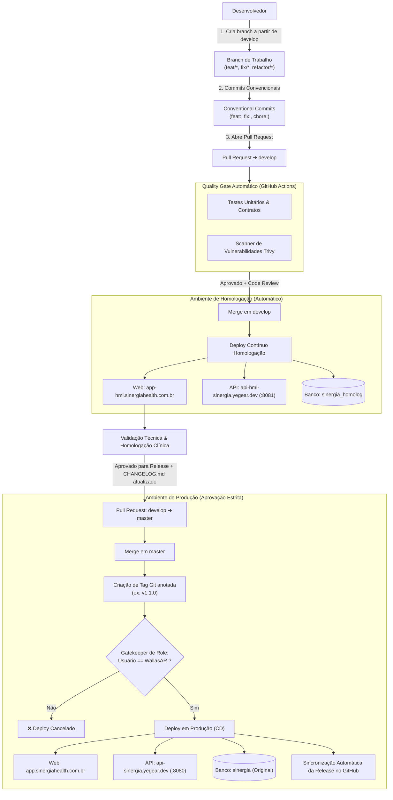

# 📘 Guia Oficial de Contribuição, GitFlow e Deploys — Sinergia Health

Este documento estabelece o procedimento operacional padrão (SOP) obrigatório para todos os desenvolvedores e colaboradores do ecossistema Sinergia (**`sinergia-api`** e **`sinergia-web`**).

---

## 🗺️ Visão Geral do Ciclo de Vida (GitFlow)



---

## 🌐 Tabela de Ambientes e Isolamento

> [!IMPORTANT]
> Os ambientes são **estritamente isolados**. Testes, inserções ou wipes em homologação **jamais** impactam os dados reais de produção.

| Parâmetro | 🧪 Homologação (Staging) | 🚀 Produção (Live) |
| :--- | :--- | :--- |
| **Frontend Web** | [`https://app-hml.sinergiahealth.com.br`](https://app-hml.sinergiahealth.com.br) | [`https://app.sinergiahealth.com.br`](https://app.sinergiahealth.com.br) |
| **Backend API** | [`https://api-hml-sinergia.yegear.dev`](https://api-hml-sinergia.yegear.dev) | [`https://api-sinergia.yegear.dev`](https://api-sinergia.yegear.dev) |
| **Branch Base** | `develop` | `master` |
| **Gatilho de Deploy** | Push / Merge na branch `develop` | Tag anotada Git `v*.*.*` |
| **Aprovação Manual** | Não (100% automatizado) | **Sim (Apenas Tech Lead `WallasAR`)** |
| **Porta no Servidor** | `:8081` | `:8080` |
| **Banco MariaDB** | `sinergia_homolog` (Volume: `mariadb_data_homolog`) | `sinergia` (Volume: `sinergia-api_mariadb_data_prod`) |
| **Storage de Mídia** | `/opt/sinergia-storage-homolog` | `/opt/sinergia-storage` |

---

## 🛠️ Passo a Passo para o Desenvolvedor

### 1. Criando sua Branch de Trabalho

Todas as novas funcionalidades e correções **devem nascer a partir da branch `develop` atualizada**:

```bash
# 1. Certifique-se de estar na develop e com o código mais recente
git checkout develop
git pull origin develop

# 2. Crie sua branch seguindo o padrão convencional
git checkout -b <tipo>/<descricao-curta>
```

#### Convenções de Nomenclatura de Branches:
* `feat/<nome>`: Nova funcionalidade (ex: `feat/escala-berg-08`, `feat/telemetria-camera`).
* `fix/<nome>`: Correção de bug (ex: `fix/calculo-angulo-joelho`, `fix/login-session-timeout`).
* `refactor/<nome>`: Refatoração que não altera comportamento (ex: `refactor/realtime-factory`).
* `chore/<nome>`: Atualização de dependências ou configurações (ex: `chore/bump-angular`).
* `docs/<nome>`: Documentação técnica ou manuais (ex: `docs/guia-telemetria`).

---

### 2. Padrão de Commits (Conventional Commits)

Adotamos a especificação de [Conventional Commits](https://www.conventionalcommits.org/pt-br/). O título do commit deve ser autoexplicativo:

```text
<tipo>(<escopo-opcional>): <descrição no imperativo e em minúsculas>
```

#### Exemplos práticos:
* `feat(biomecanica): adiciona motor de sustentacao estatica para teste de berg`
* `fix(auth): corrige validacao de expiracao do token jwt no refresh`
* `refactor(session): desacopla componente de captura da logica de upload`
* `test(contracts): adiciona fixture de teste para motor de alcance frontal`

---

### 3. Subindo alterações e abrindo Pull Request para `develop`

Ao concluir o desenvolvimento e garantir que os testes passam localmente:

```bash
git push -u origin <sua-branch>
```

1. Acesse o repositório no GitHub (`sinergia-api` ou `sinergia-web`).
2. Abra um **Pull Request** apontando para a branch **`develop`** (nunca para a `master`).
3. O GitHub Actions executará automaticamente o pipeline de CI:
   * **API**: Compilação Maven, testes JUnit/Surefire e varredura de vulnerabilidades Trivy.
   * **Web**: Testes unitários e contratos biomecânicos Karma Headless (`npm run test:headless`) e scanner Trivy.
4. Após aprovação em Code Review e 100% dos testes verdes, realize o **Merge** no `develop`.

---

### 4. Deploy Automático em Homologação

Assim que o merge na branch `develop` é concluído:
1. O workflow de CD ([`deploy-homolog.yml`](file:///d:/Projects/sinergia-web/.github/workflows/deploy-homolog.yml)) é disparado automaticamente.
2. A nova versão sobe imediatamente em:
   * **Frontend**: [`https://app-hml.sinergiahealth.com.br`](https://app-hml.sinergiahealth.com.br)
   * **Backend**: [`https://api-hml-sinergia.yegear.dev`](https://api-hml-sinergia.yegear.dev)
3. O status do deploy fica registrado na aba **Deployments ➔ homologation** do GitHub.
4. A equipe e os profissionais clínicos realizam os testes de validação neste ambiente.

---

### 5. Procedimento de Deploy para Produção (Exclusivo Tech Lead)

> [!WARNING]
> Ninguém sobe código diretamente para produção. Toda release passa compulsoriamente por Homologação, criação de Tag Semântica anotada, atualização de `CHANGELOG.md` e autorização do Tech Lead (`WallasAR`).

#### Fluxo de Promoção:

#### Passo 5.1: Atualizar o arquivo `CHANGELOG.md` na `develop` (Antes do PR para `master`)
Antes de abrir o Pull Request para a `master`, certifique-se de que o arquivo `CHANGELOG.md` já contém o registro da nova versão (ex: `## [1.1.0] - 2026-11-XX`), listando:
* 🚀 **Adicionado (Features)**
* 🔧 **Alterado & Corrigido (Fixes / Refactors)**
* 📦 **Pull Requests Integrados**

> [!IMPORTANT]
> Atualize o `CHANGELOG.md` ainda na branch da última feature/release ou via PR para a `develop`. Isso evita commits avulsos diretamente na `master` e garante que o `CHANGELOG.md` já esteja presente quando a tag `vX.Y.Z` disparar a criação automática da **GitHub Release**.

```bash
# Caso precise preparar o changelog em uma branch de release antes de promover:
git checkout develop
git pull origin develop
git checkout -b docs/changelog-v1.1.0
# Edite o CHANGELOG.md e salve
git add CHANGELOG.md
git commit -m "docs(changelog): prepara release v1.1.0"
git push -u origin docs/changelog-v1.1.0
# Abra e aprove o PR para a develop
```

#### Passo 5.2: PR de `develop` para `master`
Com todas as funcionalidades homologadas e o `CHANGELOG.md` atualizado na `develop`:
1. Abra um Pull Request de **`develop`** para **`master`**.
2. Faça a revisão final de diffs (código + `CHANGELOG.md`).
3. Conclua o Merge na `master`.

#### Passo 5.3: Criar e Publicar a Tag Semântica
Sincronize sua branch `master` local, crie a tag semântica anotada e envie para o GitHub:

```bash
git checkout master
git pull origin master

# Exemplo para release v1.1.0:
git tag -a v1.1.0 -m "Release v1.1.0 - Suporte ao Berg 08 e Ajustes de Telemetria"
git push origin v1.1.0
```

#### Passo 5.4: Validação de Segurança e Deploy
1. O push da tag dispara o workflow [`deploy-prod.yml`](file:///d:/Projects/sinergia-api/.github/workflows/deploy-prod.yml).
2. O pipeline verifica a permissão: se o autor do disparo não for **`WallasAR`**, o deploy é **imediatamente abortado**.
3. Sendo autorizado, o build de produção é gerado e publicado.
4. O container da API ou o worker do Frontend é atualizado.
5. O job `sync-release` lê automaticamente o bloco daquela versão no `CHANGELOG.md` e publica a **GitHub Release** oficial estruturada no GitHub com links para os PRs.
6. Acompanhe o status verde na aba **Deployments ➔ production**.

---

## 🆘 Checklist Rápido de Troubleshooting

* **Erro de CORS no frontend**: Certifique-se de que a origem do app (`https://app-hml.sinergiahealth.com.br` ou `https://app.sinergiahealth.com.br`) está cadastrada no `CORS_ALLOWED_ORIGINS` do `docker-compose` correspondente.
* **504 Gateway Timeout no login**: Indica preflight `OPTIONS` bloqueado por CORS ou API fora do ar.
* **502 Bad Gateway no Cloudflare Tunnel**: Verifique se o container da API (`sinergia-api-prod` ou `sinergia-api-homolog`) está ativo (`docker ps`) e se o túnel aponta para o IP `192.168.0.203` na porta correta (`:80` ou `:8081`).
* **Cache persistente no navegador**: Abra o DevTools (`F12`) ➔ **Application** ➔ **Storage** ➔ clique em **Clear site data** e recarregue com `Ctrl + F5`.
