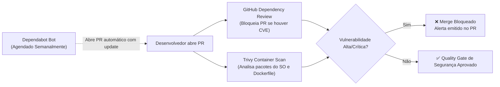
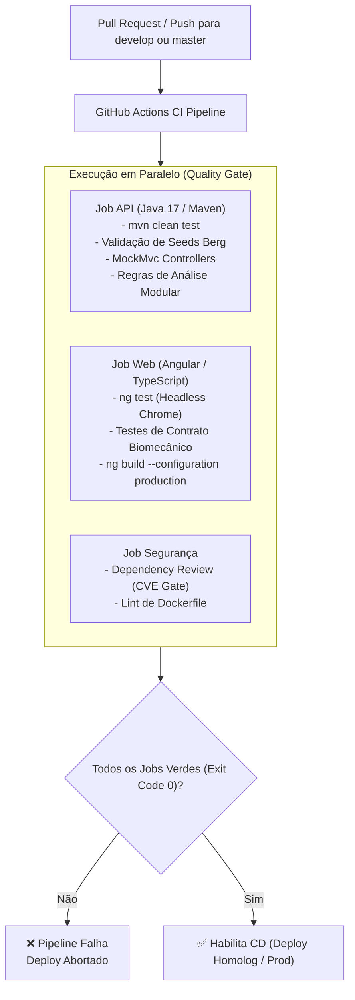
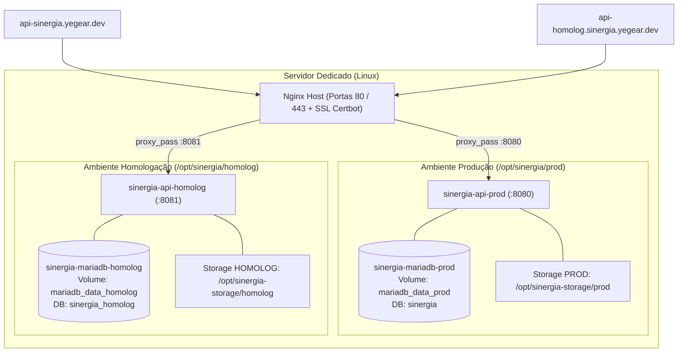
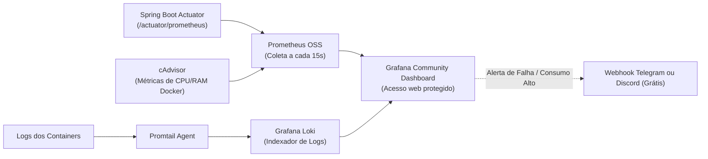

# Arquitetura de CI/CD, Governança, Segurança e Monitoramento
**Plataforma Sinergia Health**  
*Documento de Arquitetura e Engenharia de DevOps — Versão 1.1 (Zero Custos)*

---

## 1. Visão Geral e Princípios Arquiteturais

Este documento estabelece o padrão de engenharia para o ciclo de vida de desenvolvimento, validação, segurança e entrega contínua (CI/CD) do ecossistema Sinergia:
- **`sinergia-web` (Angular / TypeScript)**: Aplicação web progressiva para pacientes e profissionais. Integra nativamente e em tempo real o **motor de visão computacional e pose tracking com MediaPipe (WebAssembly / Web Workers)**, realizando o processamento biomecânico 100% no cliente e sincronizando métricas via Background Sync. *(O antigo `sinergia-worker` Python/Celery foi descontinuado e completamente incorporado ao frontend)*.
- **`sinergia-api` (Spring Boot 3 / Java 17 / MariaDB)**: API RESTful de governança clínica, prontuários, autenticação OTP, orquestração de instâncias de exercícios, telemetria e integração com IA generativa (Gemini) e síntese de voz (ElevenLabs).

### Princípios Fundamentais
1. **Zero Custo Operacional**: Utilização exclusiva de ferramentas nativas do GitHub (GitHub Actions, Dependabot, GitHub Container Registry/Runners) e ferramentas open-source auto-hospedadas no servidor dedicado (Docker Compose, MariaDB, Nginx, Grafana, Prometheus, Loki).
2. **Ambientes Estritamente Isolados**: Homologação (`homolog`) e Produção (`prod`) possuem bancos de dados, volumes, credenciais e redes Docker independentes. Homologação nunca compartilha estado nem compromete a integridade de produção.
3. **Quality Gates Inegociáveis**: Nenhuma alteração vai para deploy sem aprovação prévia em testes unitários automatizados, testes de contrato biomecânicos e auditoria de vulnerabilidades em dependências.
4. **Governança e Controle de Acesso por Role**: Deploys em produção exigem aprovação manual obrigatória de papéis autorizados (Tech Lead / Product Owner) via GitHub Environments.
5. **Rastreabilidade e Versionamento Semântico**: Cada release é atrelada a uma tag Git (`vX.Y.Z`), changelog gerado automaticamente a partir de Conventional Commits e identificadores de build injetados na aplicação.

---

## 2. Changelog Oficial Consolidado (Baseline v1.0.0)

Este changelog consolida todas as branches integradas e melhorias implementadas até o momento, servindo de base formal para a primeira release (`v1.0.0`):

```markdown
# Changelog — Sinergia Health Platform

## [v1.0.0] - 2026-11-04 (Baseline Inicial de Produção)

### 🚀 Visão Computacional & Motor Realtime no Cliente (Web Native)
- **Descontinuação do Worker Externo**: Incorporação integral do motor de análise biomecânica e tracking MediaPipe diretamente no navegador do paciente via Web Workers e WebAssembly.
- **Arquitetura Polimórfica de Exercícios (Tracks 1 a 5)**:
  - Criação do `RealtimeEngineFactory` e estratégias desacopladas para repetições dinâmicas, sustentação postural estática e alcance funcional.
  - Tipagem estrita com Discriminated Unions e validadores modulares (`RegrasAnaliseCompositeValidator`).
  - Calibração espacial antropométrica vinculada ao campo `altura_cm` do paciente para medições biomecânicas precisas.
- **Suporte Integral à Escala de Equilíbrio de Berg**:
  - Implementação dos testes e motores clínicos: Berg 02 (em pé sem apoio), Berg 03 (sentado sem apoio), Berg 07 (em pé pés juntos) e Berg 08 (alcance à frente com braço estendido / `DisplacementReachEngine`).
- **Eliminação de Flags Chumbadas no Código**:
  - Remoção de todas as strings hardcoded de infrações dos motores estáticos e perfis sagital/frontal.
  - Transição de 100% das regras para declaração dinâmica em `regras_analise.erros[]` nos JSONs de seed da API, avaliadas pelo `RuleEvaluator`.

### 🛡️ Privacidade, LGPD & Telemetria
- **Trust Center LGPD**: Painel centralizado de governança e termos de consentimento granular de captura de imagem.
- **Guards de Consentimento**: Bloqueio ativo de acesso à câmera antes da validação dos termos legais pelo paciente.
- **Telemetria de Câmera e Dispositivo**: Coleta de métricas do aparelho (resolução, orientação, FPS) para auditoria e calibração.
- **Régua de Notificações e Engajamento**: Alertas de inatividade com tolerância clínica e regras para pacientes sem sessão iniciada.

### ⚡ Experiência do Paciente & Sessão Contínua
- **Background Sync Assíncrono**: Desbloqueio imediato da navegação ao concluir a série; upload do vídeo e disparo do resumo de IA executados em segundo plano sem travar o paciente em telas de carregamento.
- **Transição de Descanso Integrada**: Modal/HUD de recuperação ativa com cronômetro regressivo, barra de progresso suave, telemetria instantânea e preview do próximo exercício.
- **Enquadramento de Câmera**: Suporte a proporções 9:16 (vertical) e 16:9 (horizontal), preservação de FOV integral do sensor e estabilização do menu lateral de controles durante o exercício.

### 🏢 B2B, Clínicas & Gestão de Acessos
- **Primeiro Acesso & Onboarding**: Fluxo fluido com código de verificação OTP, integração de convite com WhatsApp e e-mail com template clínico.
- **Gestão de Empresas e Recepcionistas**: Criação simplificada de clínicas, convites de recepcionista com campos opcionais e auditoria de acessos.
- **Prontuário & Dashboard do Profissional**: Histórico de sessões de visão computacional, evolução angular do paciente e métricas clínicas.
- **Feedback por Voz (TTS)**: Integração com ElevenLabs para geração de áudios de correção postural vinculados às flags dos exercícios.

### 🔧 Infraestrutura, Banco & Migrações
- **Flyway Migrations**: 39 migrações estruturadas e consolidadas, com correção de tipos Hibernate/Flyway (`VARCHAR` em hashes e enums).
- **Compatibilidade Cloudflare**: Configuração de SPA com workers/assets estáticos (`wrangler.jsonc`).
```

---

## 3. Segurança DevSecOps & Bots de Vulnerabilidade (Zero Custo)

Para garantir que nenhuma dependência com vulnerabilidades conhecidas (CVEs) chegue a produção, o ecossistema integrará bots e analisadores estáticos gratuitos:



### 3.1. Dependabot (Scanner e Atualizador Contínuo)
Configurado no repositório via `.github/dependabot.yml`, realiza varreduras semanais em busca de novas vulnerabilidades reportadas na base do GitHub Advisory Database:
- **Ecosystems monitorados**:
  - `maven` para `sinergia-api` (`pom.xml`).
  - `npm` para `sinergia-web` (`package.json`).
  - `docker` para imagens base (`Dockerfile`).
- **Comportamento**: Ao detectar uma vulnerabilidade, o Dependabot abre automaticamente um Pull Request com o bump da versão segura, exibindo notas de lançamento, changelog e pontuação de compatibilidade.

### 3.2. GitHub Dependency Review Action (Gatekeeper de PRs)
Executa em cada Pull Request para comparar as dependências antes e depois da alteração:
- Se uma nova biblioteca adicionada contiver vulnerabilidade com severidade **High** ou **Critical**, o status check do GitHub falha automaticamente e o botão de merge fica bloqueado.
- Exibe um comentário explicativo no próprio PR indicando a CVE e a versão mínima recomendada.

### 3.3. Trivy Container Scanner (Varredura de Imagem Docker)
Integrado na esteira de build do Docker:
- Analisa os pacotes do sistema operacional da imagem base (`eclipse-temurin:17-jre-alpine`, `mariadb:10.11`, etc.).
- Gera alertas para pacotes de sistema desatualizados antes de subir o container no servidor.

---

## 4. Quality Gates & Runner de Testes Automatizados (CI Pre-Deploy)

Antes de qualquer ação de build de imagem ou deploy nos ambientes, a esteira de CI executa em paralelo testes unitários, testes de integração e verificações de contrato:



### Detalhamento dos Jobs de Teste:
1. **API (`sinergia-api`)**:
   - `mvn clean test` (Surefire Plugin).
   - Execução obrigatória das suítes de catálogo e regras (`ExercicioSeedCatalogTest`, `RegrasAnaliseValidatorTest`, `ExercicioControllerTest`).
   - Verificação de compilação sem warnings críticos.
2. **Web (`sinergia-web`)**:
   - `npm run test:headless` (Karma com ChromeHeadless sem sandbox).
   - Validação da suite de contratos biomecânicos e testes unitários do motor estático e polimórfico (`contracts.spec.ts`, `static-posture-engine.spec.ts`).
   - `npm run build` para garantir integridade do empacotamento SPA sem erros de template.

---

## 5. Estratégia de Branching e Versionamento Semântico

### 5.1. Modelo GitFlow Simplificado
```
feature/*  ──(PR)──>  develop  ──(Deploy Homolog Automático)
                         │
                      (Testes & Validação Clínica)
                         │
                      (PR de Release)
                         │
                         ▼
                     master/main  ──(Tag vX.Y.Z)──> (Deploy Prod com Aprovação de Role)
```

- **`feature/*` e `fix/*`**: Branches de trabalho. Nunca recebem deploy direto.
- **`develop`**: Branch de integração e homologação. Qualquer merge nesta branch dispara automaticamente o deploy para o ambiente de **Homologação**.
- **`master` / `main`**: Branch de código produtivo. Apenas tags anotadas (`v1.0.0`, `v1.1.0`) disparam o deploy para **Produção**, após aprovação manual.

### 5.2. Conventional Commits e Automação de Release
Adoção do padrão Angular/Conventional Commits:
- `feat:` Nova funcionalidade (eleva versão **MINOR**, ex: `v1.1.0`).
- `fix:` Correção de bug (eleva versão **PATCH**, ex: `v1.0.1`).
- `refactor:`, `perf:`, `chore:`, `test:` Ajustes técnicos (eleva versão **PATCH** ou mantém).
- `feat!:` ou `BREAKING CHANGE:` Alteração estrutural incompatível (eleva versão **MAJOR**, ex: `v2.0.0`).

A ferramenta **Release-Please** ou workflow nativo gera automaticamente:
- Atualização do arquivo `CHANGELOG.md`.
- Atualização de versão no `pom.xml` e `package.json`.
- Criação da tag Git e GitHub Release estruturada.

---

## 6. Governança e Controle de Acesso por Role (GitHub Environments)

O GitHub Environments permite segregação estrita de variáveis e permissões entre os ambientes sem custo de licenciamento adicional:

| Configuração | Ambiente `homologation` | Ambiente `production` |
| :--- | :--- | :--- |
| **Gatilho de Ativação** | Push / Merge na branch `develop` | Criação de Tag Git `v*.*.*` |
| **Aprovação Manual** | Desativada (Deploy 100% Contínuo) | **Obrigatória (Required Reviewers)** |
| **Papéis Autorizados** | Qualquer membro com permissão de escrita | Apenas Tech Lead / Product Owner (usuários explicitamente selecionados) |
| **Secrets Associados** | Variáveis de Homologação (`DB_PASSWORD_HOMOLOG`, etc.) | Variáveis de Produção (`DB_PASSWORD_PROD`, etc.) |
| **Rollback Automático** | Re-deploy do commit anterior | Re-deploy imediato da tag estável anterior se `/actuator/health` falhar |

---

## 7. Isolamento de Ambientes no Servidor Dedicado

Como o monitoramento em tempo real roda 100% no cliente (`sinergia-web`), a infraestrutura no servidor dedicado fica muito mais leve, necessitando apenas da API, banco de dados e proxy:



### 7.1. Especificações de Isolamento
1. **Banco de Dados (MariaDB)**:
   - **Produção**: `sinergia-mariadb-prod` com volume persistente `mariadb_data_prod`. Dados reais de pacientes.
   - **Homologação**: `sinergia-mariadb-homolog` com volume `mariadb_data_homolog`. Dados sintéticos de testes. O Flyway executa migrações experimentais sem nenhum risco de quebra em produção.
2. **Storage de Vídeos e Mídias**:
   - `/opt/sinergia-storage/prod` vs `/opt/sinergia-storage/homolog`.
   - Limpeza periódica em homologação via cron job para evitar ocupação desnecessária de disco.
3. **Segurança de Credenciais**:
   - Extinção total de senhas e chaves de API em texto puro nos arquivos de compose.
   - Centralização em arquivos `.env.prod` e `.env.homolog` com permissão estrita `chmod 600`.

---

## 8. Automação do Deploy via GitHub Actions Runner

### 8.1. Arquitetura do Runner Dedicado (Zero Custo)
Em vez de depender de minutos limitados do GitHub ou expor portas SSH na internet:
- Instala-se o **GitHub Actions Self-Hosted Runner** diretamente no servidor dedicado como serviço systemd.
- O runner comunica-se com o GitHub de dentro para fora (pull seguro via HTTPS), sem necessitar de portas de entrada adicionais.
- Acesso direto ao socket local `docker.sock`, aproveitando o **cache Docker local** para builds ultra-rápidos (redução de minutos de build para segundos).

### 8.2. Pipeline de Deploy com Zero-Downtime & Healthcheck
Fluxo de execução de cada deploy da API:
```bash
# 1. Atualização do repositório no servidor
git pull origin <branch_ou_tag>

# 2. Build e reload dos containers sem derrubar o banco
docker compose -f /opt/sinergia/<ambiente>/docker-compose.yml up -d --no-deps --build api

# 3. Healthcheck automatizado de confirmação
for i in {1..12}; do
  if curl -f http://localhost:<porta>/actuator/health | grep '"status":"UP"'; then
    echo "Deploy concluído com sucesso!"
    exit 0
  fi
  sleep 5
done

# 4. Rollback imediato se não responder UP em 60s
echo "Healthcheck falhou. Iniciando rollback para imagem anterior..."
docker compose -f /opt/sinergia/<ambiente>/docker-compose.yml rollback
exit 1
```

---

## 9. Observabilidade & Monitoramento Open-Source (Grafana Stack)

Para garantir visibilidade completa sem serviços pagos (como Datadog ou New Relic), implanta-se o stack open-source leve via Docker Compose de monitoramento no próprio servidor:



### Componentes:
1. **Prometheus**: Armazena séries temporais de hardware (CPU, RAM, Disco) e de aplicação (taxa de requisições por segundo, latência percentil p95, conexões ativas no pool HikariCP).
2. **Grafana Loki + Promtail**: Centralizador de logs. Elimina a necessidade de acessar o terminal para rodar `docker logs`. Todos os logs da API ficam pesquisáveis por palavra-chave e nível (`ERROR`, `WARN`).
3. **Alertmanager com Notificação Gratuita**:
   - Disparo automático para canal de desenvolvedores no **Telegram** ou **Discord** caso:
     - Taxa de erros HTTP 500 supere 2% em 5 minutos.
     - O uso de memória RAM do servidor supere 90%.
     - Algum container de produção entre em estado `restarting` ou falhe.

---

## 10. Roadmap de Implementação por Fases

```
[ Fase 1: Governança, Changelog & GitFlow ]
 ├── Publicação deste documento e do CHANGELOG.md na raiz dos repositórios.
 ├── Criação da Tag Git oficial v1.0.0 em sinergia-api e sinergia-web.
 ├── Criação das branches 'master' e 'develop' com Branch Protection Rules.
 └── Configuração de GitHub Environments ('homologation' e 'production') com controle de role.

[ Fase 2: Segurança DevSecOps & Test Runners (CI) ]
 ├── Adição do arquivo .github/dependabot.yml em sinergia-api e sinergia-web.
 ├── Criação do workflow .github/workflows/ci.yml com matrix de testes (Surefire e Karma).
 └── Adição da verificação de vulnerabilidades (Dependency Review Action e Trivy).

[ Fase 3: Isolamento de Ambientes no Servidor ]
 ├── Configuração do subdomínio (api-homolog.sinergia.yegear.dev) no DNS.
 ├── Configuração dos arquivos /opt/sinergia/homolog/docker-compose.yml e .env.homolog.
 ├── Criação dos volumes e containers separados do MariaDB.
 └── Emissão de certificados SSL gratuitos via Let's Encrypt / Certbot no Nginx.

[ Fase 4: Automação do Deploy (CD) & Monitoramento ]
 ├── Instalação e registro do GitHub Actions Runner no servidor dedicado.
 ├── Criação dos workflows .github/workflows/deploy-homolog.yml e deploy-prod.yml.
 ├── Subida do Docker Compose de observabilidade (Grafana + Prometheus + Loki).
 └── Configuração dos dashboards e alertas gratuitos via webhook Telegram/Discord.
```
